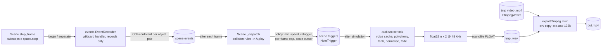

# Design — bouncekit (M0)

## 1. Architecture overview

```mermaid
flowchart LR
    script[scene script<br/>examples/single_ball.py] -->|builds| Scene
    cli[cli.py<br/>render / preview] -->|runpy + overrides| script
    cli --> Scene
    Scene -->|owns| World[world/<br/>Ball, CircleBoundary<br/>pymunk.Space]
    Scene -->|frames()| Renderer[render/<br/>Renderer protocol<br/>PygameRenderer]
    Renderer -->|reads state| World
    Scene -->|RGB bytes| Export[export/ffmpeg.py<br/>FfmpegWriter]
    Scene -->|RGB surfaces| Preview[render/preview.py<br/>pygame window]
    Export --> mp4[(out/*.mp4)]
```

Data flow per frame: `Scene.step_frame()` runs `substeps` fixed physics steps → `Renderer` draws the world (read-only) → bytes go to ffmpeg (render) or the surface is scaled to the window (preview). The simulation never reads wall-clock time; only the preview's pacing uses `pygame.time.Clock`.

## 2. Tech stack

| Concern | Choice | Why |
|---|---|---|
| Runtime | Python 3.12 via uv | SRS requires uv + ≥3.11; 3.12 is mature and supported by all deps |
| Physics | pymunk 7.3.1 | SRS; Chipmunk is deterministic when single-threaded with fixed dt |
| Rendering | pygame-ce 2.5.8 | SRS; off-screen `Surface` works without a display; `aacircle` available |
| Video | ffmpeg 9 (subprocess) | SRS; raw RGB24 pipe, no temp files |
| Tests / lint / types | pytest, ruff, mypy (dev only) | SDD quality gate (A3) |

numpy is already a declared dependency (needed from M1); M0 does not use it.

## 3. Package layout and responsibilities

```
src/bouncekit/
  __init__.py          # exports Scene, Ball, CircleBoundary, ConfigError, colors
  errors.py            # ConfigError, FfmpegError                              FR-001, FR-007
  colors.py            # Color = tuple[int,int,int]; parse_color()             FR-001
  config.py            # SceneConfig dataclass + validation                    FR-001, FR-005
  scene.py             # Scene: config, rng, object registry, step loop,
                       #   frames(), render(), preview(), run()               FR-001..FR-010
  world/
    __init__.py
    ball.py            # Ball handle (dynamic body + circle shape)            FR-004, FR-005
    circle.py          # CircleBoundary (kinematic body, N segments, gap)     FR-003
  render/
    __init__.py
    base.py            # Renderer Protocol                                    FR-008
    pygame_renderer.py # PygameRenderer (off-screen Surface)                  FR-008
    preview.py         # run_preview(): window, keys, pacing                  FR-009
  export/
    __init__.py
    ffmpeg.py          # require_ffmpeg(), FfmpegWriter context manager       FR-007
  cli.py               # argparse, load_scene(), overrides                    FR-010
examples/single_ball.py                                                       FR-011
tests/                                                                         NFR-*
```

Each world object knows how to draw itself through the `Renderer` protocol (`draw(renderer)`), so the scene just iterates its objects in insertion order.

## 4. Interfaces

### 4.1 Public API

```python
class Scene:
    def __init__(self, *, width=1080, height=1920, fps=60, duration=60.0, seed=0,
                 background="#000000", gravity=(0.0, 900.0), substeps=8,
                 max_speed=4000.0) -> None
    config: SceneConfig            # read-only after construction
    rng: random.Random
    frame: int                     # frames simulated so far
    time: float                    # frame / fps
    total_frames: int              # round(duration * fps)
    def add_circle(self, *, center, radius, thickness=8.0, color="#ffffff",
                   gap_degrees=0.0, angular_velocity=0.0, segments=128,
                   elasticity=1.0, tags=()) -> CircleBoundary
    def add_ball(self, *, pos, radius, velocity=(0.0, 0.0), elasticity=1.0,
                 color="#ffffff", tags=()) -> Ball
    def step_frame(self) -> None   # advance one frame (substeps fixed steps)
    def draw(self, renderer: Renderer) -> None
    def frames(self) -> Iterator[bytes]   # yields RGB24 for frames 0..total-1
    def render(self, out: str | Path) -> Path
    def preview(self, scale: float = 0.45) -> None
    def run(self) -> None          # CLI dispatch using sys.argv
```

`frames()` resets nothing; a scene is simulated once per process. Re-running (preview restart, determinism test) rebuilds the scene by re-executing the script / factory. This keeps "fresh scene = fresh state" trivially correct instead of writing reset logic for every object.

`Ball`: `position`, `velocity` (get/set), `radius`, `color`, `tags: frozenset[str]`, `body`, `shape` (escape hatch to pymunk).
`CircleBoundary`: `center`, `radius`, `thickness`, `gap_degrees`, `angle_degrees` (current rotation), `color`, `tags`, `body`.

### 4.2 Renderer protocol (render/base.py)

```python
class Renderer(Protocol):
    width: int; height: int
    def clear(self, color: Color) -> None
    def circle(self, center: Vec, radius: float, color: Color) -> None          # filled, AA edge
    def thick_line(self, a: Vec, b: Vec, width: float, color: Color) -> None     # round caps
    def to_rgb_bytes(self) -> bytes                                              # width*height*3
```

The ring draws one true `arc` spanning its present segments (start = first segment's start vertex, end = last segment's end vertex, plus the body rotation); a full ring when nothing is omitted. The pygame backend draws `circle`, `thick_line` and `arc` with signed-distance coverage in numpy (`clip(0.5 − d, 0, 1)` blended into `surfarray.pixels3d`), evaluated only in the shape's bounding box (arcs pre-filter to pixels within `width/2 + 1` of the circle). Chosen after the per-segment quad drawing looked visibly jagged; pygame's `aacircle` also showed stair-steps. ~16 ms per 1080×1920 frame for a ring + ball. A future skia backend implements the same methods.

### 4.3 ffmpeg (export/ffmpeg.py)

```
ffmpeg -hide_banner -loglevel error -y -f rawvideo -pix_fmt rgb24 -s {W}x{H} -r {fps} -i -
       -c:v libx264 -preset medium -crf 18 -pix_fmt yuv420p -movflags +faststart
       -fflags +bitexact -flags:v +bitexact {out}
```
`FfmpegWriter(path, width, height, fps)` is a context manager with `write(frame: bytes)`; it checks frame length, closes stdin on exit, waits, and raises `FfmpegError` with the stderr tail on non-zero exit (or on `BrokenPipeError`). `require_ffmpeg()` uses `shutil.which`, raising `FfmpegError("ffmpeg not found on PATH; install it, e.g. `brew install ffmpeg`")`. `Scene.render` calls it before simulating.

### 4.4 CLI (cli.py)

```
bouncekit render  SCENE.py [--seed N] [--duration S] [--out PATH]
bouncekit preview SCENE.py [--seed N] [--duration S] [--scale F]
```
- `load_scene(path, seed=None, duration=None) -> Scene`: sets module-level overrides in `scene.py` (`_overrides`), executes the file with `runpy.run_path(path, run_name="__bouncekit_scene__")` (so `if __name__ == "__main__"` is skipped), clears the overrides in `finally`, and returns the single `Scene` instance found in the resulting globals; otherwise raises `SceneLoadError` with the count found.
- `Scene.__init__` applies `_overrides` (seed/duration) before creating `rng`, so the script's own `scene.rng` usage follows the CLI seed.
- `Scene.run()` → `cli.main(sys.argv[1:], default_scene=Path(sys.argv[0]))`; with no subcommand it previews. It reloads the script via `load_scene` (so overrides apply), rather than using `self`.
- Importing `bouncekit` sets `PYGAME_HIDE_SUPPORT_PROMPT=1` (if unset) so the CLI prints only its own output.
- Errors (`ConfigError`, `FfmpegError`, `SceneLoadError`, missing file) print `error: ...` to stderr and exit 2; no traceback.
- Entry point: `[project.scripts] bouncekit = "bouncekit.cli:main"`.
- Implementation notes (T-006): `SceneLoadError` lives in `errors.py` (subclass of `BouncekitError`) and is also raised for a missing scene file. `main(argv=None, default_scene=None) -> int` returns the exit code (0 / 2); argparse usage errors keep argparse's own exit. The same `Scene` bound to several names counts once. `preview` loads the scene once up front so load errors exit 2 before a window opens, then hands `run_preview` a factory that reloads the script. `render/preview.py` exists as a `run_preview` placeholder until T-007.

### 4.5 Preview (render/preview.py)

`run_preview(make_scene: Callable[[], Scene], scale)` — builds a scene, opens a window of `(W·scale, H·scale)`, each loop: handle events, step if playing and not finished, draw via `PygameRenderer`, `smoothscale` to the window, `clock.tick(fps)`. R calls `make_scene()` again. The window title shows frame/total and "paused"/"done".

Implementation notes (T-007): logic lives in a `Preview` class (`handle_event`, `tick`, `run(max_frames)`); `run_preview(make_scene, scale=0.45, max_frames=None)` returns the final `Scene` (small addition for testability). Each loop draws the current frame, then steps once if playing and unfinished. `Scene.preview` passes itself first; restart reloads `sys.argv[0]` via `cli.load_scene` with the scene's seed/duration.

## 5. Physics details

- Space: `pymunk.Space()` (single-threaded), `gravity` from config, `iterations = 10` set explicitly, damping 1.0.
- Step: `dt = 1 / (fps * substeps)`; `step_frame` calls `space.step(dt)` `substeps` times. `frame += 1`.
- Ball: `Body(mass, moment)` with mass = π·r² (density 1), `moment_for_circle`; `Circle` with `elasticity`, `friction = 0`. Velocity clamp: `Scene.step_frame` calls `ball.clamp_speed(max_speed)` for every ball after **each** `space.step`. (Changed after review: a clamp in `velocity_func` missed collision impulses, which Chipmunk applies after velocity integration, so speeds reached ~4100 px/s against a spinning ring.)
- Ring: kinematic `Body` at `center`, `angular_velocity = radians(deg_per_s)` (pymunk positive angle = clockwise on screen because +y is down). Segment endpoints at angles `θ_k = 2πk/N` in body-local coords; segment k is skipped if its midpoint angle (normalised to (−180°, 180°]) has |angle| < gap/2. Consecutive present segments get `set_neighbors` for smooth seams. Each segment has `radius = thickness/2`, `elasticity`, `friction = 0`.
- Effective elasticity in pymunk is the product of both shapes; defaults 1.0 × 1.0 = 1.0.
- Tunnelling: a collision is caught only if the ball cannot cross a segment's centre line in one step, i.e. `max_speed·dt < ball.radius + thickness/2`. At 4000 px/s and dt = 1/480 s that is 8.33 px, so with an 8 px ring the ball radius must be > 4.33 px (review measured: r=4 escapes 5/8 runs, r=5 escapes 0/8). `add_ball`/`add_circle` check every new ball/ring pair and raise `ConfigError` when violated (user decision: error, not warning). NFR-003 tests the safe case; tests check the error in both insertion orders.

## 6. Determinism strategy (NFR-001)

- No wall-clock time, no unseeded randomness, no threading in the simulation. Objects are stored and drawn in insertion order (lists, not sets).
- Draw order and pixel output depend only on state; pygame software rendering is deterministic.
- Test: build a small scene (e.g. 270×480, 30 fps, 2 s) twice via a factory, hash every frame with SHA-256, and compare the lists. A second test checks that different seeds (with an rng-derived velocity) produce different hashes, which proves the hash is sensitive.

## 7. Error handling and configuration

- All config validation happens at construction (`SceneConfig.__post_init__`, `add_*`) and raises `ConfigError("<field> must be ...; got <value>")`.
- Config is dataclasses (`SceneConfig`, frozen). No config files in M0.
- No logging framework; the CLI prints one line when the render finishes (`wrote out/x.mp4 (N frames)`).

## 8. Testing strategy

| Test file | Covers |
|---|---|
| `tests/test_config.py` | FR-001 defaults/validation, colours, FR-003/FR-004 validation |
| `tests/test_world.py` | FR-002 gravity direction, FR-003 gap passes ball / closed ring holds it / rotation, FR-005 step count + clamp, NFR-003 no tunnelling, seam smoothness (ball rolls along bottom without speed spikes) |
| `tests/test_render.py` | FR-008 frame size/colour pixels, NFR-004 rendering doesn't mutate physics |
| `tests/test_determinism.py` | NFR-001 frame-hash equality; different seed differs |
| `tests/test_export.py` | FR-007 tiny real ffmpeg encode probed with ffprobe; missing ffmpeg error (monkeypatched `shutil.which`); bad frame length |
| `tests/test_cli.py` | FR-010 load_scene single/zero/many, overrides applied before script code, `__main__` block not run, missing file, render subcommand end-to-end on a tiny scene |

Preview (FR-009) is tested by running `run_preview` with `SDL_VIDEODRIVER=dummy` for a few frames with a test hook (`max_frames` argument), plus manual check.

## 9. Key decisions

| Decision | Alternatives | Why chosen |
|---|---|---|
| Re-run the script for restart / determinism instead of `Scene.reset()` | Snapshot & restore pymunk state | Rebuild is always correct and needs no per-object reset code |
| CLI overrides via module-level `_overrides` read in `Scene.__init__` | Parse `sys.argv` inside `Scene`; require a `make_scene(seed)` factory | Keeps the SRS script shape; works for both `bouncekit render` and `python scene.py` |
| Objects draw themselves via the Renderer protocol | Renderer knows every object type | Adding an object type touches one file; backends only implement primitives |
| Ring = N straight segments with `set_neighbors` | pymunk `Poly`, or analytic circle collision | SRS asks for arc segments; supports gaps and rotation directly |
| Velocity clamp in `velocity_func` | Clamp after `space.step` | Applied every substep inside pymunk's integration, before position update |

---

## M1 — Audio pipeline

### M1.1 Overview



Physics emits events; the scene turns events into note triggers each frame (outside callbacks); the mixer turns triggers into samples once, after the simulation. Rendering frames and audio never feed back into physics.

### M1.2 Modules (new/changed)

```
src/bouncekit/
  events.py          # CollisionEvent, EventRecorder (wildcard handler)        FR-101
  sound.py           # public: note(), scale(), Note, Scale, pitch parsing,
                     #   re-exports voice classes (Sine, Triangle, Pluck,
                     #   Marimba, ADSR) and voice name lookup                   FR-102, FR-103
  actions.py         # public: play(), Play                                     FR-104
  audio/
    __init__.py
    voices.py        # ADSR, Sine, Triangle, Pluck, Marimba; VOICES name map    FR-105
    mixer.py         # SAMPLE_RATE, NoteTrigger, sample_offset(), mix()         FR-106, FR-107
  export/
    ffmpeg.py        # + mux(video, wav, out)                                   FR-109
    audio.py         # write_wav(path, buffer)                                  FR-109
  config.py          # + AudioConfig; SceneConfig gains `audio: AudioConfig`    FR-108
  scene.py           # recorder install, step bookkeeping, on_collision,
                     #   _dispatch, events/triggers, audio_buffer(), render()   FR-101..FR-109
  __init__.py        # + AudioConfig, actions, sound
examples/bounce_notes.py                                                         FR-110
```

`AudioConfig` is defined in `config.py` next to `SceneConfig` (it reuses the validators there); `audio/` imports it from `config.py`.

### M1.3 Public API

```python
from bouncekit import Scene, AudioConfig, actions as A, sound as S

scene = Scene(..., audio=AudioConfig(max_polyphony=24))          # audio is optional
ring = scene.add_circle(center=(540, 960), radius=450, tags={"wall"})
scene.add_ball(pos=(540, 700), radius=30, tags={"ball"})
scene.on_collision("ball", "wall", [A.play(S.scale("C4", voice="pluck"))])
```

```python
# config.py
@dataclass(frozen=True)
class AudioConfig:
    min_impact_speed: float = 40.0        # px/s, >= 0
    reference_speed: float = 1500.0       # px/s, > 0; speed giving full gain
    min_retrigger_interval: float = 0.05  # s, >= 0; per (play action, object a)
    max_triggers_per_frame: int = 6       # >= 1, all rules together
    max_polyphony: int = 24               # >= 1
    peak_dbfs: float = -1.0               # <= 0
SAMPLE_RATE = 48_000                      # constant, in audio/mixer.py

# SceneConfig: new field `audio: AudioConfig = AudioConfig()`; Scene(..., audio=None) -> default.

# sound.py
Pitch = str | int | float                 # name | MIDI 0..127 | Hz
VoiceLike = str | Voice                   # "sine" | "triangle" | "pluck" | "marimba" | instance
def note(pitch: Pitch, *, voice: VoiceLike = "sine") -> Note
def scale(root: Pitch = "C4", *, mode: str = "major_pentatonic", octaves: int = 2,
          voice: VoiceLike = "sine") -> Scale
@dataclass(frozen=True) class Note:  hz: float; voice: Voice
@dataclass(frozen=True, eq=False) class Scale: hz: tuple[float, ...]; voice: Voice
    # eq=False: identity matters, one cursor per instance
def pitch_to_hz(pitch: Pitch) -> float     # ConfigError on bad input
Source = Note | Scale

# actions.py
@dataclass(frozen=True, eq=False) class Play: source: Source; gain: float = 1.0
def play(source: Source, *, gain: float = 1.0) -> Play   # gain >= 0

# audio/voices.py  (all frozen dataclasses; render(hz, seed) -> NDArray[float64], mono, 48 kHz)
@dataclass(frozen=True) class ADSR: attack=0.005, decay=0.15, sustain=0.5, release=0.4  # seconds/level
@dataclass(frozen=True) class Sine:     duration: float = 0.8; envelope: ADSR = ADSR()
@dataclass(frozen=True) class Triangle: duration: float = 0.8; envelope: ADSR = ADSR()
@dataclass(frozen=True) class Pluck:    duration: float = 1.5; damping: float = 0.996
@dataclass(frozen=True) class Marimba:  duration: float = 1.2; decay: float = 0.35  # s, fundamental
Voice = Sine | Triangle | Pluck | Marimba
VOICES: dict[str, Voice] = {"sine": Sine(), "triangle": Triangle(), "pluck": Pluck(), "marimba": Marimba()}

# events.py
@dataclass(frozen=True)
class CollisionEvent:
    kind: Literal["collision"]
    step: int                     # global physics step (1-based, end of step)
    frame: int                    # video frame being simulated (frame index before increment)
    time: float                   # step / (fps * substeps)
    objects: tuple[WorldObject, WorldObject]   # in pymunk shape order
    speed: float                  # px/s along the contact normal, pre-impulse
    position: Vec                 # contact point, screen px

# audio/mixer.py
@dataclass(frozen=True)
class NoteTrigger: step: int; offset: int; voice: Voice; hz: float; gain: float
def sample_offset(step: int, fps: int, substeps: int) -> int
    # (2 * step * SAMPLE_RATE + fps * substeps) // (2 * fps * substeps)
def num_samples(frames: int, fps: int) -> int
    # (2 * frames * SAMPLE_RATE + fps) // (2 * fps)
def mix(triggers: Sequence[NoteTrigger], *, length: int, config: AudioConfig,
        seed: int) -> NDArray[np.float32]   # shape (length, 2)

# Scene additions
def on_collision(self, tag_a: str, tag_b: str, actions: Sequence[Play]) -> None
events: tuple[CollisionEvent, ...]       # property
triggers: tuple[NoteTrigger, ...]        # property
has_sound: bool                          # property: any rule with a Play
def audio_buffer(self) -> NDArray[np.float32]   # mix for frames simulated so far

# export
def write_wav(path: Path, buffer: NDArray[np.float32]) -> None      # soundfile, FLOAT
def mux(video: Path, wav: Path, out: Path) -> None                  # FfmpegError on failure
```

### M1.4 Event recording (FR-101)

- `Scene.__init__` keeps `self._owner: dict[pymunk.Shape, WorldObject]` (filled by `add_ball`/`add_circle`; never iterated) and installs `EventRecorder` via `space.on_collision(begin=rec.begin, separate=rec.separate)` (wildcard; verified: `Space.on_collision(collision_type_a=None, collision_type_b=None, begin=..., separate=...)` in pymunk 7.3.1).
- `step_frame` sets `rec.step` before each `space.step` (`self._step += 1`, so the value is the end-of-step count) and `rec.frame`.
- `begin(arb, space, data)`: map `arb.shapes` to owners (skip if either unknown or both the same object); `key = (i, j)`, the two objects' insertion indices sorted ascending (the scene stores an index per object at add time; `id()` is never used); `contacts[key] += 1`; if the count went 0 → 1 or the key already has a pending event **in this step**, compute speed and record/merge (keep max speed). Speed: `p = contact_point_set.points[0]`, point = midpoint of `point_a`/`point_b`; `rel = body_a.velocity_at_world_point(pt) - body_b.velocity_at_world_point(pt)`; `abs(rel.dot(arb.normal))`. Never touches the space.
- `separate(...)`: `contacts[key] -= 1` (delete at 0).
- Seam behaviour (measured in M1 planning): a ball landing on a seam fires two `begin`s in one substep; the per-step merge produces one event. Rolling onto the next segment fires a `begin` while the previous segment pair is still in contact; the counter suppresses it. Chipmunk runs `begin` for new pairs before `separate` for stale pairs within a step, so the count does not dip to 0 between them (T-101 has a regression test).
- Events recorded in a step are appended to `scene._events` in order at the end of that step.

### M1.5 Dispatch and trigger policy (FR-103, FR-104, FR-106)

After each frame's substeps, `Scene._dispatch(events_of_this_frame)`:
```
frame_count = 0
for ev in frame events:                         # log order
    for rule in self._rules:                    # registration order
        a, b = match(rule, ev)                  # a carries tag_a; None if no match
        for play in rule.actions:
            if ev.speed < cfg.min_impact_speed: continue
            last = self._last_trigger.get((play, a))     # dict keyed by object identity
            if last is not None and ev.time - last < cfg.min_retrigger_interval: continue
            if frame_count >= cfg.max_triggers_per_frame: continue
            hz = next_hz(play.source)           # Note: fixed; Scale: cursor[source] advances
            gain = play.gain * min(1.0, ev.speed / cfg.reference_speed) ** 0.5
            append NoteTrigger(step, sample_offset(step, ...), voice, hz, gain)
            self._last_trigger[(play, a)] = ev.time; frame_count += 1
```
Cursor state lives in the scene (`dict[Scale, int]`, `Scale` hashes by identity), so sources stay immutable values and a fresh scene starts every cursor at 0.

### M1.6 Mixer (FR-105, FR-106, FR-107)

1. Voice stealing pass (integer samples, trigger order): keep a deque of `(start, end, index)` for sounding notes; drop those with `end <= start_new`; if `len == max_polyphony`, set the oldest's `end = start_new + fade` (fade = 240 samples = 5 ms) and mark it to fade over `[start_new, start_new + fade)`.
2. Render: `cache[(voice, hz, seed)] = voice.render(hz, seed)` (float64). For each trigger, `note = cached[:end - start].copy()`, apply the steal fade if any, multiply by `gain × NOTE_LEVEL` (0.5), add into a float64 mono accumulator at `[start : min(start + len, length)]`.
3. Master: `y = tanh(acc)`; if `peak > 0`: `y *= 10 ** (peak_dbfs / 20) / peak`; linear fade over the final 240 samples; duplicate to two channels; `astype(float32)`.
- All operations are float64 numpy on contiguous arrays in a fixed order, so the output is bit-identical for identical inputs on the same machine and library versions. No FFT, threads or wall-clock.

Voices (`render(hz, seed)`, `n = round(duration × 48000)` samples, `t = arange(n) / 48000`):
- `Sine`/`Triangle`: oscillator from phase 0 (`sin`, or `2/π · arcsin(sin)`) × ADSR (`attack` ramp from 0, `decay` to `sustain`, hold, `release` to 0 ending at `duration`; if `attack + decay + release > duration` scale the three to fit).
- `Pluck`: Karplus-Strong. Delay length `N = max(2, round(48000 / hz))`; initial buffer = uniform noise in [−1, 1] from `default_rng([seed % 2**32, round(hz * 1000), round(damping * 1e6)])`, mean removed; loop `y[i] = damping · 0.5 · (y[i−N] + y[i−N−1])` in vectorised blocks of `N`; `y[0] = 0`; 2 ms attack ramp; normalised to peak 1.
- `Marimba`: partials at ratios 1, 3.93 (+−) and 9.3 with amplitudes 1, 0.35, 0.1 and decay times `decay`, `decay/3`, `decay/8`; 1 ms attack; partials above 20 kHz omitted; normalised to peak 1.

### M1.7 Export (FR-109)

```
Scene.render(out):
    require_ffmpeg(); out.parent.mkdir(...)
    if not self.has_sound: (M0 path, unchanged)
    else:
        with tempfile.TemporaryDirectory(dir=out.parent) as tmp:
            encode frames -> tmp/video.mp4 (FfmpegWriter, unchanged)
            write_wav(tmp/audio.wav, self.audio_buffer())
            mux(tmp/video.mp4, tmp/audio.wav, out)
mux: ffmpeg -hide_banner -loglevel error -y -i VIDEO -i WAV -map 0:v:0 -map 1:a:0
     -c:v copy -c:a aac -b:a 192k -ar 48000 -ac 2 -movflags +faststart
     -fflags +bitexact OUT
```
AAC encoder delay is recorded by ffmpeg as an edit list in MP4, so players align audio to t = 0; the ffprobe duration test (NFR-102) guards against gross offsets.

### M1.8 Determinism strategy (NFR-101)

- Event identity is insertion-index based; dicts are insertion-ordered or lookup-only; `id()` is never used for ordering.
- Sample offsets are exact integer arithmetic on the step count (no float `time × 48000`).
- Pluck noise seeds derive from scene seed + note parameters, not from a shared stream, so caching and trigger order cannot change sound.
- Tests: two fresh builds of the same scene → `audio_buffer().tobytes()` equal and `events` equal (compare `(step, speed, position, object indices)`); different seed → buffers differ.

### M1.8a Implementation notes (T-101)

- `SAMPLE_RATE` lives in `audio/voices.py` (voices need it and the mixer imports voices); `audio/mixer.py` re-exports it, so `from bouncekit.audio.mixer import SAMPLE_RATE` works as designed.
- Staged within M1: after T-101 `VOICES` holds only `"sine"`, `Source = Note`, `AudioConfig` validates only `peak_dbfs` (and `SceneConfig.audio`'s type), and `_dispatch` applies no trigger policy (gain = `play.gain`, no polyphony limit). T-102/T-103 add the rest.
- `EventRecorder` stores `owners: dict[Shape, (index, object)]` itself (instead of `Scene._owner`); lookup only, never iterated.
- Temp dir for muxing is `.bouncekit-*` inside `out.parent`.

### M1.9 Key decisions and alternatives

| Decision | Chosen | Alternatives (rejected because) |
|---|---|---|
| Event capture | one wildcard `begin` + `separate`, record only | per-tag-pair handlers via `collision_type` (needs type allocation; tags are many-to-many; M2 can still dispatch by tags in Python) |
| Impact speed | relative velocity along normal at `begin` | `post_solve` `total_impulse` (mass dependent, needs extra callback, fires every step of contact) |
| Seam/rolling duplicates | per-pair contact count + per-step merge | time-based debounce only (would still fire on slow rolling; needs magic interval) |
| When rules run | after each frame, outside callbacks | inside callback (violates P4 for M2 actions); after whole sim (M2 actions must affect physics during sim) |
| Mixing | offline once after simulation | streaming per frame (more complex, no benefit offline) |
| Polyphony overflow | steal oldest with 5 ms fade | drop new (silences new hits during exponential growth — the moments that matter) |
| Pluck noise seed | `(seed, hz, damping)` | per-trigger index (defeats the note cache; identical-pitch plucks sounding identical is acceptable) |
| No sound rules | video-only MP4 (M0 output) | silent AAC track (extra encode, changes M0 output for no benefit) |
| Limiter | `tanh` + peak normalise | look-ahead compressor (more code; tanh is transparent at normal levels) |
| WAV format | 32-bit float | 16-bit PCM (quantises the deterministic buffer; AAC re-encodes anyway) |
