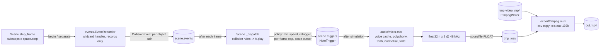
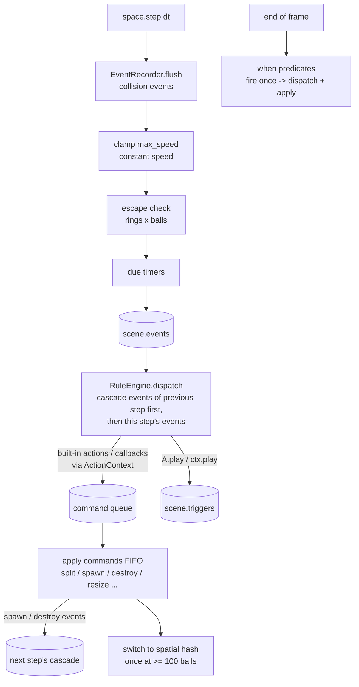
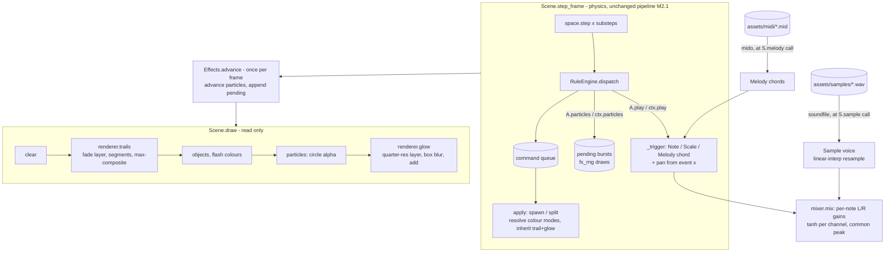

# Design — bouncekit (M0)

## 1. Architecture overview

```mermaid
flowchart LR
    script[scene script<br/>examples/single_ball.py] -->|builds| Scene
    cli[cli.py<br/>render / preview] -->|runpy + overrides| script
    cli --> Scene
    Scene -->|owns| World[world/<br/>Ball, CircleBoundary<br/>pymunk.Space]
    Scene -->|frames()| Renderer[render/<br/>Renderer protocol<br/>PygameRenderer]
    Renderer -->|reads state| World
    Scene -->|RGB bytes| Export[export/ffmpeg.py<br/>FfmpegWriter]
    Scene -->|RGB surfaces| Preview[render/preview.py<br/>pygame window]
    Export --> mp4[(out/*.mp4)]
```

Data flow per frame: `Scene.step_frame()` runs `substeps` fixed physics steps → `Renderer` draws the world (read-only) → bytes go to ffmpeg (render) or the surface is scaled to the window (preview). The simulation never reads wall-clock time; only the preview's pacing uses `pygame.time.Clock`.

## 2. Tech stack

| Concern | Choice | Why |
|---|---|---|
| Runtime | Python 3.12 via uv | SRS requires uv + ≥3.11; 3.12 is mature and supported by all deps |
| Physics | pymunk 7.3.1 | SRS; Chipmunk is deterministic when single-threaded with fixed dt |
| Rendering | pygame-ce 2.5.8 | SRS; off-screen `Surface` works without a display; `aacircle` available |
| Video | ffmpeg 9 (subprocess) | SRS; raw RGB24 pipe, no temp files |
| Tests / lint / types | pytest, ruff, mypy (dev only) | SDD quality gate (A3) |

numpy is already a declared dependency (needed from M1); M0 does not use it.

## 3. Package layout and responsibilities

```
src/bouncekit/
  __init__.py          # exports Scene, Ball, CircleBoundary, ConfigError, colors
  errors.py            # ConfigError, FfmpegError                              FR-001, FR-007
  colors.py            # Color = tuple[int,int,int]; parse_color()             FR-001
  config.py            # SceneConfig dataclass + validation                    FR-001, FR-005
  scene.py             # Scene: config, rng, object registry, step loop,
                       #   frames(), render(), preview(), run()               FR-001..FR-010
  world/
    __init__.py
    ball.py            # Ball handle (dynamic body + circle shape)            FR-004, FR-005
    circle.py          # CircleBoundary (kinematic body, N segments, gap)     FR-003
  render/
    __init__.py
    base.py            # Renderer Protocol                                    FR-008
    pygame_renderer.py # PygameRenderer (off-screen Surface)                  FR-008
    preview.py         # run_preview(): window, keys, pacing                  FR-009
  export/
    __init__.py
    ffmpeg.py          # require_ffmpeg(), FfmpegWriter context manager       FR-007
  cli.py               # argparse, load_scene(), overrides                    FR-010
examples/single_ball.py                                                       FR-011
tests/                                                                         NFR-*
```

Each world object knows how to draw itself through the `Renderer` protocol (`draw(renderer)`), so the scene just iterates its objects in insertion order.

## 4. Interfaces

### 4.1 Public API

```python
class Scene:
    def __init__(self, *, width=1080, height=1920, fps=60, duration=60.0, seed=0,
                 background="#000000", gravity=(0.0, 900.0), substeps=8,
                 max_speed=4000.0) -> None
    config: SceneConfig            # read-only after construction
    rng: random.Random
    frame: int                     # frames simulated so far
    time: float                    # frame / fps
    total_frames: int              # round(duration * fps)
    def add_circle(self, *, center, radius, thickness=8.0, color="#ffffff",
                   gap_degrees=0.0, angular_velocity=0.0, segments=128,
                   elasticity=1.0, tags=()) -> CircleBoundary
    def add_ball(self, *, pos, radius, velocity=(0.0, 0.0), elasticity=1.0,
                 color="#ffffff", tags=()) -> Ball
    def step_frame(self) -> None   # advance one frame (substeps fixed steps)
    def draw(self, renderer: Renderer) -> None
    def frames(self) -> Iterator[bytes]   # yields RGB24 for frames 0..total-1
    def render(self, out: str | Path) -> Path
    def preview(self, scale: float = 0.45) -> None
    def run(self) -> None          # CLI dispatch using sys.argv
```

`frames()` resets nothing; a scene is simulated once per process. Re-running (preview restart, determinism test) rebuilds the scene by re-executing the script / factory. This keeps "fresh scene = fresh state" trivially correct instead of writing reset logic for every object.

`Ball`: `position`, `velocity` (get/set), `radius`, `color`, `tags: frozenset[str]`, `body`, `shape` (escape hatch to pymunk).
`CircleBoundary`: `center`, `radius`, `thickness`, `gap_degrees`, `angle_degrees` (current rotation), `color`, `tags`, `body`.

### 4.2 Renderer protocol (render/base.py)

```python
class Renderer(Protocol):
    width: int; height: int
    def clear(self, color: Color) -> None
    def circle(self, center: Vec, radius: float, color: Color) -> None          # filled, AA edge
    def thick_line(self, a: Vec, b: Vec, width: float, color: Color) -> None     # round caps
    def to_rgb_bytes(self) -> bytes                                              # width*height*3
```

The ring draws one true `arc` spanning its present segments (start = first segment's start vertex, end = last segment's end vertex, plus the body rotation); a full ring when nothing is omitted. The pygame backend draws `circle`, `thick_line` and `arc` with signed-distance coverage in numpy (`clip(0.5 − d, 0, 1)` blended into `surfarray.pixels3d`), evaluated only in the shape's bounding box (arcs pre-filter to pixels within `width/2 + 1` of the circle). Chosen after the per-segment quad drawing looked visibly jagged; pygame's `aacircle` also showed stair-steps. ~16 ms per 1080×1920 frame for a ring + ball. A future skia backend implements the same methods.

### 4.3 ffmpeg (export/ffmpeg.py)

```
ffmpeg -hide_banner -loglevel error -y -f rawvideo -pix_fmt rgb24 -s {W}x{H} -r {fps} -i -
       -c:v libx264 -preset medium -crf 18 -pix_fmt yuv420p -movflags +faststart
       -fflags +bitexact -flags:v +bitexact {out}
```
`FfmpegWriter(path, width, height, fps)` is a context manager with `write(frame: bytes)`; it checks frame length, closes stdin on exit, waits, and raises `FfmpegError` with the stderr tail on non-zero exit (or on `BrokenPipeError`). `require_ffmpeg()` uses `shutil.which`, raising `FfmpegError("ffmpeg not found on PATH; install it, e.g. `brew install ffmpeg`")`. `Scene.render` calls it before simulating.

### 4.4 CLI (cli.py)

```
bouncekit render  SCENE.py [--seed N] [--duration S] [--out PATH]
bouncekit preview SCENE.py [--seed N] [--duration S] [--scale F]
```
- `load_scene(path, seed=None, duration=None) -> Scene`: sets module-level overrides in `scene.py` (`_overrides`), executes the file with `runpy.run_path(path, run_name="__bouncekit_scene__")` (so `if __name__ == "__main__"` is skipped), clears the overrides in `finally`, and returns the single `Scene` instance found in the resulting globals; otherwise raises `SceneLoadError` with the count found.
- `Scene.__init__` applies `_overrides` (seed/duration) before creating `rng`, so the script's own `scene.rng` usage follows the CLI seed.
- `Scene.run()` → `cli.main(sys.argv[1:], default_scene=Path(sys.argv[0]))`; with no subcommand it previews. It reloads the script via `load_scene` (so overrides apply), rather than using `self`.
- Importing `bouncekit` sets `PYGAME_HIDE_SUPPORT_PROMPT=1` (if unset) so the CLI prints only its own output.
- Errors (`ConfigError`, `FfmpegError`, `SceneLoadError`, missing file) print `error: ...` to stderr and exit 2; no traceback.
- Entry point: `[project.scripts] bouncekit = "bouncekit.cli:main"`.
- Implementation notes (T-006): `SceneLoadError` lives in `errors.py` (subclass of `BouncekitError`) and is also raised for a missing scene file. `main(argv=None, default_scene=None) -> int` returns the exit code (0 / 2); argparse usage errors keep argparse's own exit. The same `Scene` bound to several names counts once. `preview` loads the scene once up front so load errors exit 2 before a window opens, then hands `run_preview` a factory that reloads the script. `render/preview.py` exists as a `run_preview` placeholder until T-007.

### 4.5 Preview (render/preview.py)

`run_preview(make_scene: Callable[[], Scene], scale)` — builds a scene, opens a window of `(W·scale, H·scale)`, each loop: handle events, step if playing and not finished, draw via `PygameRenderer`, `smoothscale` to the window, `clock.tick(fps)`. R calls `make_scene()` again. The window title shows frame/total and "paused"/"done".

Implementation notes (T-007): logic lives in a `Preview` class (`handle_event`, `tick`, `run(max_frames)`); `run_preview(make_scene, scale=0.45, max_frames=None)` returns the final `Scene` (small addition for testability). Each loop draws the current frame, then steps once if playing and unfinished. `Scene.preview` passes itself first; restart reloads `sys.argv[0]` via `cli.load_scene` with the scene's seed/duration.

## 5. Physics details

- Space: `pymunk.Space()` (single-threaded), `gravity` from config, `iterations = 10` set explicitly, damping 1.0.
- Step: `dt = 1 / (fps * substeps)`; `step_frame` calls `space.step(dt)` `substeps` times. `frame += 1`.
- Ball: `Body(mass, moment)` with mass = π·r² (density 1), `moment_for_circle`; `Circle` with `elasticity`, `friction = 0`. Velocity clamp: `Scene.step_frame` calls `ball.clamp_speed(max_speed)` for every ball after **each** `space.step`. (Changed after review: a clamp in `velocity_func` missed collision impulses, which Chipmunk applies after velocity integration, so speeds reached ~4100 px/s against a spinning ring.)
- Ring: kinematic `Body` at `center`, `angular_velocity = radians(deg_per_s)` (pymunk positive angle = clockwise on screen because +y is down). Segment endpoints at angles `θ_k = 2πk/N` in body-local coords; segment k is skipped if its midpoint angle (normalised to (−180°, 180°]) has |angle| < gap/2. Consecutive present segments get `set_neighbors` for smooth seams. Each segment has `radius = thickness/2`, `elasticity`, `friction = 0`.
- Effective elasticity in pymunk is the product of both shapes; defaults 1.0 × 1.0 = 1.0.
- Tunnelling: a collision is caught only if the ball cannot cross a segment's centre line in one step, i.e. `max_speed·dt < ball.radius + thickness/2`. At 4000 px/s and dt = 1/480 s that is 8.33 px, so with an 8 px ring the ball radius must be > 4.33 px (review measured: r=4 escapes 5/8 runs, r=5 escapes 0/8). `add_ball`/`add_circle` check every new ball/ring pair and raise `ConfigError` when violated (user decision: error, not warning). NFR-003 tests the safe case; tests check the error in both insertion orders.

## 6. Determinism strategy (NFR-001)

- No wall-clock time, no unseeded randomness, no threading in the simulation. Objects are stored and drawn in insertion order (lists, not sets).
- Draw order and pixel output depend only on state; pygame software rendering is deterministic.
- Test: build a small scene (e.g. 270×480, 30 fps, 2 s) twice via a factory, hash every frame with SHA-256, and compare the lists. A second test checks that different seeds (with an rng-derived velocity) produce different hashes, which proves the hash is sensitive.

## 7. Error handling and configuration

- All config validation happens at construction (`SceneConfig.__post_init__`, `add_*`) and raises `ConfigError("<field> must be ...; got <value>")`.
- Config is dataclasses (`SceneConfig`, frozen). No config files in M0.
- No logging framework; the CLI prints one line when the render finishes (`wrote out/x.mp4 (N frames)`).

## 8. Testing strategy

| Test file | Covers |
|---|---|
| `tests/test_config.py` | FR-001 defaults/validation, colours, FR-003/FR-004 validation |
| `tests/test_world.py` | FR-002 gravity direction, FR-003 gap passes ball / closed ring holds it / rotation, FR-005 step count + clamp, NFR-003 no tunnelling, seam smoothness (ball rolls along bottom without speed spikes) |
| `tests/test_render.py` | FR-008 frame size/colour pixels, NFR-004 rendering doesn't mutate physics |
| `tests/test_determinism.py` | NFR-001 frame-hash equality; different seed differs |
| `tests/test_export.py` | FR-007 tiny real ffmpeg encode probed with ffprobe; missing ffmpeg error (monkeypatched `shutil.which`); bad frame length |
| `tests/test_cli.py` | FR-010 load_scene single/zero/many, overrides applied before script code, `__main__` block not run, missing file, render subcommand end-to-end on a tiny scene |

Preview (FR-009) is tested by running `run_preview` with `SDL_VIDEODRIVER=dummy` for a few frames with a test hook (`max_frames` argument), plus manual check.

## 9. Key decisions

| Decision | Alternatives | Why chosen |
|---|---|---|
| Re-run the script for restart / determinism instead of `Scene.reset()` | Snapshot & restore pymunk state | Rebuild is always correct and needs no per-object reset code |
| CLI overrides via module-level `_overrides` read in `Scene.__init__` | Parse `sys.argv` inside `Scene`; require a `make_scene(seed)` factory | Keeps the SRS script shape; works for both `bouncekit render` and `python scene.py` |
| Objects draw themselves via the Renderer protocol | Renderer knows every object type | Adding an object type touches one file; backends only implement primitives |
| Ring = N straight segments with `set_neighbors` | pymunk `Poly`, or analytic circle collision | SRS asks for arc segments; supports gaps and rotation directly |
| Velocity clamp in `velocity_func` | Clamp after `space.step` | Applied every substep inside pymunk's integration, before position update |

---

## M1 — Audio pipeline

### M1.1 Overview



Physics emits events; the scene turns events into note triggers each frame (outside callbacks); the mixer turns triggers into samples once, after the simulation. Rendering frames and audio never feed back into physics.

### M1.2 Modules (new/changed)

```
src/bouncekit/
  events.py          # CollisionEvent, EventRecorder (wildcard handler)        FR-101
  sound.py           # public: note(), scale(), Note, Scale, pitch parsing,
                     #   re-exports voice classes (Sine, Triangle, Pluck,
                     #   Marimba, ADSR) and voice name lookup                   FR-102, FR-103
  actions.py         # public: play(), Play                                     FR-104
  audio/
    __init__.py
    voices.py        # ADSR, Sine, Triangle, Pluck, Marimba; VOICES name map    FR-105
    mixer.py         # SAMPLE_RATE, NoteTrigger, sample_offset(), mix()         FR-106, FR-107
  export/
    ffmpeg.py        # + mux(video, wav, out)                                   FR-109
    audio.py         # write_wav(path, buffer)                                  FR-109
  config.py          # + AudioConfig; SceneConfig gains `audio: AudioConfig`    FR-108
  scene.py           # recorder install, step bookkeeping, on_collision,
                     #   _dispatch, events/triggers, audio_buffer(), render()   FR-101..FR-109
  __init__.py        # + AudioConfig, actions, sound
examples/bounce_notes.py                                                         FR-110
```

`AudioConfig` is defined in `config.py` next to `SceneConfig` (it reuses the validators there); `audio/` imports it from `config.py`.

### M1.3 Public API

```python
from bouncekit import Scene, AudioConfig, actions as A, sound as S

scene = Scene(..., audio=AudioConfig(max_polyphony=24))  # audio is optional
ring = scene.add_circle(center=(540, 960), radius=450, tags={"wall"})
scene.add_ball(pos=(540, 700), radius=30, tags={"ball"})
scene.on_collision("ball", "wall", [A.play(S.scale("C4", voice="pluck"))])
```

```python
# config.py
@dataclass(frozen=True)
class AudioConfig:
    min_impact_speed: float = 40.0        # px/s, >= 0
    reference_speed: float = 1500.0       # px/s, > 0; speed giving full gain
    min_retrigger_interval: float = 0.05  # s, >= 0; per (play action, object a)
    max_triggers_per_frame: int = 6       # >= 1, all rules together
    max_polyphony: int = 24               # >= 1
    peak_dbfs: float = -1.0               # <= 0
SAMPLE_RATE = 48_000                      # constant, in audio/mixer.py

# SceneConfig: new field `audio: AudioConfig = AudioConfig()`; Scene(..., audio=None) -> default.

# sound.py
Pitch = str | int | float                 # name | MIDI 0..127 | Hz
VoiceLike = str | Voice                   # "sine" | "triangle" | "pluck" | "marimba" | instance
def note(pitch: Pitch, *, voice: VoiceLike = "sine") -> Note
def scale(root: Pitch = "C4", *, mode: str = "major_pentatonic", octaves: int = 2,
          voice: VoiceLike = "sine") -> Scale
@dataclass(frozen=True) class Note:  hz: float; voice: Voice
@dataclass(frozen=True, eq=False) class Scale: hz: tuple[float, ...]; voice: Voice
    # eq=False: identity matters, one cursor per instance
def pitch_to_hz(pitch: Pitch) -> float     # ConfigError on bad input
Source = Note | Scale

# actions.py
@dataclass(frozen=True, eq=False) class Play: source: Source; gain: float = 1.0
def play(source: Source, *, gain: float = 1.0) -> Play   # gain >= 0

# audio/voices.py  (all frozen dataclasses; render(hz, seed) -> NDArray[float64], mono, 48 kHz)
@dataclass(frozen=True) class ADSR: attack=0.005, decay=0.15, sustain=0.5, release=0.4  # seconds/level
@dataclass(frozen=True) class Sine:     duration: float = 0.8; envelope: ADSR = ADSR()
@dataclass(frozen=True) class Triangle: duration: float = 0.8; envelope: ADSR = ADSR()
@dataclass(frozen=True) class Pluck:    duration: float = 1.5; damping: float = 0.996
@dataclass(frozen=True) class Marimba:  duration: float = 1.2; decay: float = 0.35  # s, fundamental
Voice = Sine | Triangle | Pluck | Marimba
VOICES: dict[str, Voice] = {"sine": Sine(), "triangle": Triangle(), "pluck": Pluck(), "marimba": Marimba()}

# events.py
@dataclass(frozen=True)
class CollisionEvent:
    kind: Literal["collision"]
    step: int                     # global physics step (1-based, end of step)
    frame: int                    # video frame being simulated (frame index before increment)
    time: float                   # step / (fps * substeps)
    objects: tuple[WorldObject, WorldObject]   # in pymunk shape order
    speed: float                  # px/s along the contact normal, pre-impulse
    position: Vec                 # contact point, screen px

# audio/mixer.py
@dataclass(frozen=True)
class NoteTrigger: step: int; offset: int; voice: Voice; hz: float; gain: float
def sample_offset(step: int, fps: int, substeps: int) -> int
    # (2 * step * SAMPLE_RATE + fps * substeps) // (2 * fps * substeps)
def num_samples(frames: int, fps: int) -> int
    # (2 * frames * SAMPLE_RATE + fps) // (2 * fps)
def mix(triggers: Sequence[NoteTrigger], *, length: int, config: AudioConfig,
        seed: int) -> NDArray[np.float32]   # shape (length, 2)

# Scene additions
def on_collision(self, tag_a: str, tag_b: str, actions: Sequence[Play]) -> None
events: tuple[CollisionEvent, ...]       # property
triggers: tuple[NoteTrigger, ...]        # property
has_sound: bool                          # property: any rule with a Play
def audio_buffer(self) -> NDArray[np.float32]   # mix for frames simulated so far

# export
def write_wav(path: Path, buffer: NDArray[np.float32]) -> None      # soundfile, FLOAT
def mux(video: Path, wav: Path, out: Path) -> None                  # FfmpegError on failure
```

### M1.4 Event recording (FR-101)

- `Scene.__init__` keeps `self._owner: dict[pymunk.Shape, WorldObject]` (filled by `add_ball`/`add_circle`; never iterated) and installs `EventRecorder` via `space.on_collision(begin=rec.begin, separate=rec.separate)` (wildcard; verified: `Space.on_collision(collision_type_a=None, collision_type_b=None, begin=..., separate=...)` in pymunk 7.3.1).
- `step_frame` sets `rec.step` before each `space.step` (`self._step += 1`, so the value is the end-of-step count) and `rec.frame`.
- `begin(arb, space, data)`: map `arb.shapes` to owners (skip if either unknown or both the same object); `key = (i, j)`, the two objects' insertion indices sorted ascending (the scene stores an index per object at add time; `id()` is never used); `contacts[key] += 1`; if the count went 0 → 1 or the key already has a pending event **in this step**, compute speed and record/merge (keep max speed). Speed: `p = contact_point_set.points[0]`, point = midpoint of `point_a`/`point_b`; `rel = body_a.velocity_at_world_point(pt) - body_b.velocity_at_world_point(pt)`; `abs(rel.dot(arb.normal))`. Never touches the space.
- `separate(...)`: `contacts[key] -= 1` (delete at 0).
- Seam behaviour (measured in M1 planning): a ball landing on a seam fires two `begin`s in one substep; the per-step merge produces one event. Rolling onto the next segment fires a `begin` while the previous segment pair is still in contact; the counter suppresses it. Chipmunk runs `begin` for new pairs before `separate` for stale pairs within a step, so the count does not dip to 0 between them (T-101 has a regression test).
- Events recorded in a step are appended to `scene._events` in order at the end of that step.

### M1.5 Dispatch and trigger policy (FR-103, FR-104, FR-106)

After each frame's substeps, `Scene._dispatch(events_of_this_frame)`:
```
frame_count = 0
for ev in frame events:                         # log order
    for rule in self._rules:                    # registration order
        a, b = match(rule, ev)                  # a carries tag_a; None if no match
        for play in rule.actions:
            if ev.speed < cfg.min_impact_speed: continue
            last = self._last_trigger.get((play, a))     # dict keyed by object identity
            if last is not None and ev.time - last < cfg.min_retrigger_interval: continue
            if frame_count >= cfg.max_triggers_per_frame: continue
            hz = next_hz(play.source)           # Note: fixed; Scale: cursor[source] advances
            gain = play.gain * min(1.0, ev.speed / cfg.reference_speed) ** 0.5
            append NoteTrigger(step, sample_offset(step, ...), voice, hz, gain)
            self._last_trigger[(play, a)] = ev.time; frame_count += 1
```
Cursor state lives in the scene (`dict[Scale, int]`, `Scale` hashes by identity), so sources stay immutable values and a fresh scene starts every cursor at 0.

### M1.6 Mixer (FR-105, FR-106, FR-107)

1. Voice stealing pass (integer samples, trigger order): keep a deque of `(start, end, index)` for sounding notes; drop those with `end <= start_new`; if `len == max_polyphony`, set the oldest's `end = start_new + fade` (fade = 240 samples = 5 ms) and mark it to fade over `[start_new, start_new + fade)`.
2. Render: `cache[(voice, hz, seed)] = voice.render(hz, seed)` (float64). For each trigger, `note = cached[:end - start].copy()`, apply the steal fade if any, multiply by `gain × NOTE_LEVEL` (0.5), add into a float64 mono accumulator at `[start : min(start + len, length)]`.
3. Master: `y = tanh(acc)`; if `peak > 0`: `y *= 10 ** (peak_dbfs / 20) / peak`; linear fade over the final 240 samples; duplicate to two channels; `astype(float32)`.
- All operations are float64 numpy on contiguous arrays in a fixed order, so the output is bit-identical for identical inputs on the same machine and library versions. No FFT, threads or wall-clock.

Voices (`render(hz, seed)`, `n = round(duration × 48000)` samples, `t = arange(n) / 48000`):
- `Sine`/`Triangle`: oscillator from phase 0 (`sin`, or `2/π · arcsin(sin)`) × ADSR (`attack` ramp from 0, `decay` to `sustain`, hold, `release` to 0 ending at `duration`; if `attack + decay + release > duration` scale the three to fit).
- `Pluck`: Karplus-Strong. Delay length `N = max(2, round(48000 / hz − 0.5))` (T-102 deviation: the two-tap average adds half a sample of loop delay, so `round(48000 / hz)` played 880 Hz 1.7 % flat); the loop then sounds at `48000 / (N + 0.5)`, so the string is rendered to `m = ceil((n − 1) · ratio) + 2` samples and read back with `np.interp` at `arange(n) · ratio`, `ratio = hz · (N + 0.5) / 48000`, which is exact pitch (M1 review fix: the integer delay alone was +14 cents at C6, +33 at C7; a fractional allpass would need a per-sample Python loop). Initial buffer = uniform noise in [−1, 1] from `default_rng([seed % 2**32, round(hz * 1000), round(damping * 1e6)])`, smoothed by one circular `[1, 2, 1] / 4` pass (M1 review fix: full-band noise had a true peak 1.43× the sample peak and overshot after AAC), mean removed; loop `y[i] = damping · 0.5 · (y[i−N] + y[i−N−1])` in vectorised blocks of `N`; `y[0] = 0`; 2 ms attack ramp; 50 ms linear release to 0 at the end; normalised to peak 1.
- `Marimba`: partials at ratios 1, 3.93 (+−) and 9.3 with amplitudes 1, 0.35, 0.1 and decay times `decay`, `decay/3`, `decay/8`; 1 ms attack; partials above 20 kHz omitted; 50 ms linear release to 0 at the end (M1 review fix: the note was cut while still sounding, a click); normalised to peak 1.
- Delivery headroom (FR-109): `true_peak(buf)` interpolates each channel 8× by FFT in 65 536-sample blocks with 4 096 samples of context per side (edge error ≈ 1e-4; 0.6 s per 60 s stereo); `limit_true_peak(buf, peak_dbfs=…)` scales the buffer by `ceiling / true_peak` only when the true peak is above `10 ** (peak_dbfs / 20)`. `Scene.render` applies it before `write_wav`. It is separate from `mix()` so the mix keeps its exact sample-peak contract (NFR-103) and stays FFT-free; numpy's FFT is deterministic for a fixed machine and numpy version. A windowed-sinc FIR (BS.1770 style) was tried and under-read saturated onsets by ~2 %.

### M1.7 Export (FR-109)

```
Scene.render(out):
    require_ffmpeg(); out.parent.mkdir(...)
    if not self.has_sound: (M0 path, unchanged)
    else:
        with tempfile.TemporaryDirectory(dir=out.parent) as tmp:
            encode frames -> tmp/video.mp4 (FfmpegWriter, unchanged)
            write_wav(tmp/audio.wav, limit_true_peak(self.audio_buffer(), peak_dbfs=…))
            mux(tmp/video.mp4, tmp/audio.wav, out)
mux: ffmpeg -hide_banner -loglevel error -y -i VIDEO -i WAV -map 0:v:0 -map 1:a:0
     -c:v copy -c:a aac -b:a 192k -ar 48000 -ac 2 -movflags +faststart
     -fflags +bitexact OUT
```
AAC encoder delay is recorded by ffmpeg as an edit list in MP4, so players align audio to t = 0; the ffprobe duration test (NFR-102) guards against gross offsets.

### M1.8 Determinism strategy (NFR-101)

- Event identity is insertion-index based; dicts are insertion-ordered or lookup-only; `id()` is never used for ordering.
- Sample offsets are exact integer arithmetic on the step count (no float `time × 48000`).
- Pluck noise seeds derive from scene seed + note parameters, not from a shared stream, so caching and trigger order cannot change sound.
- Tests: two fresh builds of the same scene → `audio_buffer().tobytes()` equal and `events` equal (compare `(step, speed, position, object indices)`); different seed → buffers differ.

### M1.8a Implementation notes (T-101)

- `SAMPLE_RATE` lives in `audio/voices.py` (voices need it and the mixer imports voices); `audio/mixer.py` re-exports it, so `from bouncekit.audio.mixer import SAMPLE_RATE` works as designed.
- Staged within M1: after T-101 `VOICES` holds only `"sine"`, `Source = Note`, `AudioConfig` validates only `peak_dbfs` (and `SceneConfig.audio`'s type), and `_dispatch` applies no trigger policy (gain = `play.gain`, no polyphony limit). T-102/T-103 add the rest.
- T-102: `Triangle` uses the exact piecewise-linear form `1 − 4·|frac(hz·t + ¼) − ½|` (identical shape to `2/π · arcsin(sin)`, exact 0 at t = 0). `Pluck` treats `y[−1]` as 0 for the first output sample. Pitch tests measure the fundamental by autocorrelation, because a plucked string's loudest partial can be a harmonic.
- `EventRecorder` stores `owners: dict[Shape, (index, object)]` itself (instead of `Scene._owner`); lookup only, never iterated.
- Temp dir for muxing is `.bouncekit-*` inside `out.parent`.

- T-103: `scale()` raises `ConfigError` when its top note exceeds 20 kHz (same range rule as `pitch_to_hz`; the spec was silent). `Scale.hz` is `root_hz × 2^(k/12)`. Retrigger check uses the exact step gap, `(step − last_step) / (fps × substeps) < min_retrigger_interval` (one correctly rounded division), instead of subtracting float times, so a gap of exactly the interval plays; `_last_trigger` stores steps. `mix()` stably sorts triggers by `offset` (scene triggers are already in that order) and skips triggers at or past the buffer end before the stealing pass; a stolen note is removed from the sounding list and its fade uses `linspace(1, 0, 240)` like the end fade. AudioConfig validation cases live in tests/test_policy.py (not test_config.py).

### M1.9 Key decisions and alternatives

| Decision | Chosen | Alternatives (rejected because) |
|---|---|---|
| Event capture | one wildcard `begin` + `separate`, record only | per-tag-pair handlers via `collision_type` (needs type allocation; tags are many-to-many; M2 can still dispatch by tags in Python) |
| Impact speed | relative velocity along normal at `begin` | `post_solve` `total_impulse` (mass dependent, needs extra callback, fires every step of contact) |
| Seam/rolling duplicates | per-pair contact count + per-step merge | time-based debounce only (would still fire on slow rolling; needs magic interval) |
| When rules run | after each frame, outside callbacks | inside callback (violates P4 for M2 actions); after whole sim (M2 actions must affect physics during sim) |
| Mixing | offline once after simulation | streaming per frame (more complex, no benefit offline) |
| Polyphony overflow | steal oldest with 5 ms fade | drop new (silences new hits during exponential growth — the moments that matter) |
| Pluck noise seed | `(seed, hz, damping)` | per-trigger index (defeats the note cache; identical-pitch plucks sounding identical is acceptable) |
| No sound rules | video-only MP4 (M0 output) | silent AAC track (extra encode, changes M0 output for no benefit) |
| Limiter | `tanh` + peak normalise | look-ahead compressor (more code; tanh is transparent at normal levels) |
| WAV format | 32-bit float | 16-bit PCM (quantises the deterministic buffer; AAC re-encodes anyway) |

---

## M2 — Rules engine

### M2.1 Overview



Nothing mutates the space between `space.step` entry and the end of dispatch. Commands run in the window after dispatch and before the next `space.step`, which is equivalent to a pymunk post-step callback but keeps all mutation in one ordered place.

### M2.2 Modules (new/changed)

```
src/bouncekit/
  events.py          # Event (CollisionEvent = Event alias), EventKind; EventRecorder
                     #   unchanged except indices come from the scene counter      FR-201
  actions.py         # public built-ins: Play (unchanged), Split, Spawn, Destroy,
                     #   Recolor, Resize, SetVelocity, Flash, EndAfter + factory
                     #   functions; each has run(ctx) and SUBJECT field `target`   FR-206..FR-210
  rules/
    __init__.py      # re-exports ActionContext
    context.py       # ActionContext (queues commands, ctx.play), Command dataclasses FR-203
    engine.py        # Rule, RuleEngine: registration, matching, cooldowns,
                     #   timers, escapes, when, dispatch                             FR-202..FR-204, FR-208, FR-209
    commands.py      # apply(scene, command): split/spawn/destroy/resize/... with
                     #   cap + tunnelling refusal                                    FR-205..FR-210
  world/ball.py      # + generation, alive, constant_speed, target_speed,
                     #   color setter, set_radius(), draw(renderer, color=None)    FR-206, FR-210, FR-212
  world/circle.py    # + alive, color setter, draw(renderer, color=None)
  config.py          # SceneConfig + rule_cooldown, max_balls                      FR-204, FR-205
  scene.py           # owns RuleEngine; on_* / every / at / when; count();
                     #   step loop per M2.1; _spawn_ball/_remove internals;
                     #   flash state; end_after; render audio decision               all
examples/split_on_wall.py, escape_rotating_gap.py, destroy_on_contact.py           FR-213
```

`rules/` imports `world/`, `events`, `actions` types only through `TYPE_CHECKING` where needed to avoid cycles; `actions.py` calls `ctx.<method>` so it does not import `rules`.

### M2.3 Public API

```python
from bouncekit import Scene, actions as A, sound as S

scene = Scene(..., max_balls=1000, rule_cooldown=0.05)
ring = scene.add_circle(center=(540, 960), radius=450, gap_degrees=30,
                        angular_velocity=45, tags={"wall"})
scene.add_ball(pos=(540, 700), radius=20, velocity=(300, 0), constant_speed=True, tags={"ball"})

scene.on_collision("ball", "wall", [A.split(into=2, spread_degrees=30, max_total=256),
                                    A.play(S.scale("C4", voice="pluck")),
                                    A.flash(ring, seconds=0.08)])

@scene.on_collision("ball", "ball")
def custom(ctx, a, b, contact):
    if a.radius > 30:
        ctx.destroy(a)

scene.on_escape(ring, "ball", [A.destroy(), A.play(S.note("C6"))])
scene.every(2.0, [A.spawn(pos=(540, 960), radius=15, velocity=lambda ctx: (ctx.rng.uniform(-300, 300), 0))])
scene.when(lambda w: w.count("ball") >= 500, [A.end_after(seconds=3)])
```

```python
# events.py
EventKind = Literal["collision", "escape", "spawn", "destroy", "timer", "condition"]
@dataclass(frozen=True)
class Event:
    kind: EventKind; step: int; frame: int; time: float
    objects: tuple[WorldObject, ...]      # see FR-201
    speed: float | None                   # None for timer/condition
    position: Vec | None
CollisionEvent = Event                    # M1 name kept

# actions.py  (all frozen dataclasses, eq=False -> identity; validated in factories)
Target = Literal["a", "b"] | WorldObject
Handler = Action | Callable[..., object]
def split(*, into=2, spread_degrees=30.0, radius_scale=1.0, max_total=None, target="a") -> Split
def spawn(*, pos, radius, velocity=(0.0, 0.0), count=1, color="#ffffff", tags=("ball",),
          elasticity=1.0, constant_speed=False, max_total=None) -> Spawn
          # pos / velocity / color: value or Callable[[ActionContext], value]
def destroy(*, target="a") -> Destroy
def recolor(color, *, target="a") -> Recolor
def resize(*, radius=None, scale=None, target="a") -> Resize
def set_velocity(*, velocity=None, speed=None, target="a") -> SetVelocity
def flash(target="a", *, seconds=0.08, color="#ffffff") -> Flash
def play(source, *, gain=1.0) -> Play                       # unchanged
def end_after(seconds) -> EndAfter
Action = Play | Split | Spawn | Destroy | Recolor | Resize | SetVelocity | Flash | EndAfter
# each: def run(self, ctx: ActionContext) -> None  (resolves target, calls ctx.<method>)

# rules/context.py
class ActionContext:
    scene: Scene; event: Event; a: WorldObject | None; b: WorldObject | None
    rng: random.Random            # scene.rng
    time: float                   # event.time
    def destroy(self, obj: WorldObject) -> None
    def split(self, ball: Ball, *, into=2, spread_degrees=30.0, radius_scale=1.0, max_total=None) -> None
    def spawn(self, *, pos, radius, velocity=(0.0, 0.0), count=1, color="#ffffff",
              tags=("ball",), elasticity=1.0, constant_speed=False, max_total=None) -> None
    def recolor(self, obj: WorldObject, color: ColorLike) -> None
    def resize(self, ball: Ball, radius: float) -> None
    def set_velocity(self, ball: Ball, velocity: Vec) -> None
    def flash(self, obj: WorldObject, *, seconds=0.08, color="#ffffff") -> None
    def play(self, source: Source, *, gain=1.0) -> None     # immediate trigger (policy applies)
    def end_after(self, seconds: float) -> None
# All but play append a Command (frozen dataclass: DestroyCmd, SplitCmd, SpawnCmd, RecolorCmd,
# ResizeCmd, VelocityCmd, FlashCmd, EndCmd) to scene's queue. Values are validated here
# (ConfigError) so a bad call in a callback fails at its source.

# Scene additions
Scene(..., max_balls: int = 1000, rule_cooldown: float = 0.05)
def on_collision(self, tag_a, tag_b, handlers=None, *, cooldown=None, object_cooldown=0.0)
def on_escape(self, ring: CircleBoundary, tag: str, handlers=None, *, margin=0.0)
def on_spawn(self, tag: str, handlers=None)
def on_destroy(self, tag: str, handlers=None)
def every(self, seconds: float, handlers=None)
def at(self, seconds: float, handlers=None)
def when(self, predicate: Callable[[Scene], bool], handlers=None)
    # each: handlers given -> None; omitted -> decorator returning the function
def count(self, tag: str | None = None) -> int
def add_ball(self, *, ..., constant_speed: bool = False) -> Ball
objects: tuple[WorldObject, ...]   # live only
total_frames: int                  # may shrink via end_after

# Ball additions
generation: int; alive: bool; constant_speed: bool; target_speed: float
color: Color (settable)            # CircleBoundary: alive, color settable too
```

### M2.4 Rule engine (FR-202..FR-204, FR-208, FR-209)

```python
@dataclass(eq=False)
class Rule:
    kind: Literal["collision", "escape", "spawn", "destroy", "timer", "condition"]
    handlers: tuple[Handler, ...]
    tag_a: str | None = None; tag_b: str | None = None     # collision; tag_a for escape/spawn/destroy
    ring: CircleBoundary | None = None; margin: float = 0.0
    cooldown: float = 0.0; object_cooldown: float = 0.0          # seconds
    period: int = 0; at_step: int = 0                         # timers, in steps
    predicate: Callable | None = None; fired: bool = False    # when
    index: int                                                # registration order
```

- Matching per event kind: collision as M1 (`a` carries `tag_a`); escape: `rule.ring is ring and tag in ball.tags`; spawn/destroy: `tag in obj.tags`; timer: only the rule that produced the event (`TimerEvent` carries no rule, so the engine dispatches timer events directly to their rule rather than matching); condition: same.
- Cooldown state: `last_pair: dict[(rule.index, i, j), step]`, `last_object: dict[(rule.index, i), step]` keyed by object indices (lookup only). Check = exact step gap, as M1 (`(step − last) / rate < cooldown`). Only non-play handlers are gated; when gated handlers run, the timestamps update. Play handlers go straight to the M1 policy function.
- The M1 policy body of `Scene._dispatch` is factored into `_trigger(play, event, a)`; `Scene._dispatch(events)` remains as the entry point (M1 tests call it directly) and delegates to `RuleEngine.dispatch`. The per-frame cap counts `dict[frame, int]`, keyed by `event.frame` (entries for older frames are deleted when a newer frame appears).
- Object indices: `Scene._next_index` (monotonic, never reused) replaces `len(self._objects)` when registering with the recorder, so removal never aliases keys.
- Escape state: `escaped: set[(ring_idx, ball_idx)]` is lookup-only; iteration is over `scene._rings`/`scene._balls` lists in insertion order, restricted to rings that have escape rules and balls matching any of that ring's tags. Distance check uses `math.hypot` on positions after the step.
- Timers: computed at registration in steps; at each step the engine checks `step % period == 0` / `step == at_step` over timer rules in registration order and emits `Event(kind="timer", objects=(), speed=None, position=None)`.
- `when`: after the frame, for rules with `fired == False` in registration order: if `predicate(scene)`: set fired, log `Event("condition", step=last step of the frame, ...)`, dispatch that rule only, apply commands.
- Handler call: for an `Action`, `handler.run(ctx)`; for a callable, the per-kind signature (FR-202). A fresh `ActionContext` per (event, rule).

### M2.4a Implementation notes (T-201)

- Staged within M2: after T-201 `RuleKind` is `"collision" | "destroy"`, `Rule` has only the fields those kinds use (`kind, handlers, index, tag_a, tag_b, cooldown, object_cooldown`), the command queue holds only `DestroyCmd`, and `SceneConfig` gains only `rule_cooldown` (`max_balls` comes with T-202). Escape/timer/spawn/condition kinds, `ctx.split`/`spawn`/... are added by their tasks.
- `Scene._rules` is kept as a read-only M1 view, `[(tag_a, tag_b, handlers)]` of the collision rules, because an M1 test indexes it (NFR-204). Rules live in `scene._engine.rules`.
- `ctx.play(source, gain=)` validates through `A.play` and then shares one `Play` per equal `(source, gain)` (engine lookup dict), so the retrigger key `(play, a)` of FR-211 is stable across calls; a fresh `Play` per call would never retrigger-limit callback sounds.
- The registration helper is shared, so `on_destroy` already accepts the decorator form (T-203 adds the remaining methods and their tests).
- A destroyed ring's destroy event has `speed=0.0` and `position=ring.center`. `space.remove` runs the recorder's `separate` synchronously (verified in pymunk 7.3.1), so contact counts drop at once; the removed shapes are then dropped from `EventRecorder.owners`.
- `step_frame` skips dispatch when there are no rules or no pending events and skips command application when the queue is empty (same behaviour, less per-step work). Commands queued outside dispatch (e.g. a test calling `ctx.destroy`) are applied by the next `_apply_commands`.
- `render`: rule-less scenes encode straight to `out` (M0 path); with rules, the video goes to the temp dir and is muxed iff `has_sound or triggers`, else moved to `out` with `Path.replace`.

### M2.5 Commands (FR-205..FR-210)

`apply(scene, cmd)` in `rules/commands.py`; every function first checks `target.alive` and the target type (no-op otherwise).

- **Split**: `r' = r · radius_scale`; refuse if `scene.count_balls − 1 + into > min(max_balls, max_total or ∞)` or `_tunnels(r')` against any live ring (same formula as `Scene._check_tunnelling`, but returning bool). Otherwise compute `θ`, `s`, offsets per FR-206, then `_clear_of_rings` translates the formation clear of ring walls (FR-206, C16: inner limit `R·cos(π/segments) − t/2 − r' − 0.5`, outer `R + t/2 + r' + 0.5`, worst child first, ≤ 8 passes per ring, rings with the parent centre inside their band skipped); parent: `set_radius(r')`, position/velocity of child 0, `generation += 1`; children 1..into−1 via `scene._spawn_ball(...)` (registers with recorder, objects list after the parent's current last object, i.e. appended) inheriting fields; copy the parent's `last_pair`/`last_object`/M1 `_last_trigger` entries to each child index. Emit spawn events in child order.
- **Spawn**: values were resolved when the handler ran (callables evaluated during dispatch, in ball order — deterministic rng consumption); refuse whole command on cap/tunnelling; else `_spawn_ball` per ball; spawn events.
- Spawn/destroy events take `frame` from `Scene._sim_frame` (the frame of the latest simulated step), so commands applied by `when` rules after `self.frame += 1` still log the frame they belong to (FR-201); the FR-211 per-frame cap keys on it.
- **Destroy**: `space.remove(body, *shapes)` (fires `separate` outside the step → recorder counts drop), remove from `_objects`/`_balls`/`_rings` (list remove, O(n), fine at ≤ 1000), `alive = False`, destroy event.
- **Resize**: `shape.unsafe_set_radius(r)`, `body.mass = π r²`, `body.moment = moment_for_circle(...)`; refuse on tunnelling.
- **SetVelocity**: set, then clamp to `max_speed`; constant-speed balls update `target_speed`.
- **Recolor**: set base colour. **Flash**: `scene._flash[obj_index] = (color, start_frame, n_frames)`; `Scene.draw` passes `color = lerp(flash, base, (frame − start) / n)` while `0 ≤ frame − start < n`, where `start` = the frame count after the current frame completes (the next drawn frame). **End**: `total_frames = min(total_frames, frames_after_current + round(seconds·fps))`.
- After applying the queue: if not yet hashed and live balls ≥ 100: `space.use_spatial_hash(2 × max radius, 10_000)` (verified signature in pymunk 7.3.1: `use_spatial_hash(dim: float, count: int)`).

Constant speed (FR-212): in the step loop right after `clamp_speed`: `if ball.constant_speed: ball.renormalize()` (scale to `target_speed` when speed > 0). `target_speed ≤ max_speed` is validated at creation, so the clamp and the renormalisation never fight.

### M2.5a Implementation notes (T-202)

- (Superseded by T-204, §M2.5c.) `A.spawn`/`ctx.spawn` did not take `constant_speed` before T-204: constant speed (FR-212) arrives with T-204, which adds the option to `spawn`, `add_ball` and the split inheritance (the split speed `s` is `|v|` until then). Avoids a parameter that silently does nothing.
- `ctx.split(ring)` is accepted and ignored (FR-206 no-op), matching `A.split` on a ring subject; any other non-handle raises `ConfigError`.
- Spawned balls are not speed-clamped at creation (as `add_ball`); the post-step clamp applies from the next step. The spawn event's `speed` is the ball's speed as created.
- Callable results are validated when evaluated (`ConfigError` naming `pos`/`velocity`/`color`, raised in the handler that called `spawn`); all callables run before the cap/tunnelling check, so a refused spawn still consumes the same `rng` values (deterministic).
- Cooldown inheritance copies every `last_pair`/`last_object` entry of the parent's index to the child (`RuleEngine.inherit`) and every `(play, parent)` retrigger timestamp to `(play, child)`; the copy loops are over lookup dicts and do not affect any iteration order.
- `Scene._tunnels(radius, ring)` is the shared predicate; `_check_tunnelling` raises with it at script time, split/spawn refuse with it at runtime.

### M2.5b Implementation notes (T-203)

- Escape threshold with several escape rules on one ring: the (ring, ball) pair escapes once (FR-208), so a single threshold is needed; it uses the **smallest** `margin` among that ring's escape rules whose tag the ball carries, and the one event dispatches to all of them. With one rule per ring (every example) this is exactly FR-208.
- Timer events are logged after the step's escape events and run directly on the rule that produced them (`RuleEngine.run`) right after `dispatch` of the cascade/collision/escape events, which keeps FR-203's log order (collisions, escapes, timers) without tagging events with rules.
- `when` predicates run after `self.frame += 1`, so `scene.frame`/`scene.time` inside a predicate already count the completed frame; the condition event has `frame` = the frame just simulated and `step` = its last step. Commands queued there are applied at once (per rule).
- `F` of FR-209 is `Scene._frames_done`: `frame + 1` while `step_frame` runs a frame's steps, `frame` afterwards (when rules, or commands applied outside a frame). `EndCmd` stores `round(seconds × fps)` frames, computed when queued.
- Subject validation error names the rule kind and the registration method, e.g. `... which a timer rule (every) does not have`.
- `scene.when(predicate)` rejects built-in actions as the predicate as well as non-callables.

### M2.5c Implementation notes (T-204)

- `A.resize(scale=)` and `A.set_velocity(speed=)` are resolved when the command is applied (radius / direction at apply time), so two scale commands in one queue compound; `radius=`/`velocity=` (value or `f(ctx)`, evaluated during dispatch) are absolute. `ctx.resize(ball, radius)` and `ctx.set_velocity(ball, velocity)` keep the design signatures; the speed form exists only on the action.
- `set_velocity(speed=)` on a ball at rest leaves it at rest (no direction). A constant-speed ball's `target_speed` becomes the resulting `|v|` after the clamp (0 if at rest, which then holds it at rest).
- `ctx.resize`/`ctx.set_velocity` on a ring are accepted no-ops (as `ctx.split`, C23); any other non-handle raises `ConfigError`. `recolor` and `flash` work on balls and rings.
- Flash state lives in `Scene._flash[obj_index] = (colour, start, frames)` (lookup only; a new flash on the same object replaces the old). `start = _frames_done` when applied, i.e. the next drawn frame; `Scene.draw` blends `round(flash + (base − flash)·k/frames)` per channel for `0 ≤ k < frames`, against the base colour at draw time.
- `constant_speed` on `spawn`: a constant zero velocity is rejected at `A.spawn(...)`; speeds above `max_speed` (unknown at construction) and callable results are checked when the handler evaluates them (`ConfigError`, as other invalid callable results). Spawned and split balls get `target_speed = |initial velocity|`; split uses the parent's `target_speed` as `s` for constant-speed parents.
- The spatial-hash check (`len(_balls) ≥ 100`, `SPATIAL_HASH_BALLS`) runs after each step's command application, so balls added by `add_ball` before the first step switch at step 1.
- The engine runs built-in actions via `isinstance(handler, <action union>)`; `ACTION_TYPES` lists all nine for registration checks.

### M2.6 Determinism strategy (NFR-201)

- One ordered pipeline per step (M2.1); all containers iterated are lists in insertion order; dicts/sets keyed by monotonic object indices or rule indices are lookup-only; `id()` never orders anything.
- All randomness in actions comes from `ctx.rng` (= `scene.rng`), consumed in dispatch order; spawn callables run during dispatch, not at apply time, so the order is fixed by (event, rule, handler, ball index).
- Spatial-hash switch happens at a deterministic step with deterministic parameters; Chipmunk's results with the hash are deterministic for a fixed build.
- Cascades are bounded to one level per step, so an on_spawn → spawn chain cannot loop inside one step.
- Tests: two builds of a split scene → equal frame hashes, `audio_buffer().tobytes()`, and event keys `(kind, step, object indices, speed, position)`; seed change differs.

### M2.7 Rendering and audio impact

- `Ball.draw(renderer, color=None)` / `CircleBoundary.draw(renderer, color=None)`: `None` → base colour. Only `Scene.draw` passes flash colours; renderer protocol unchanged.
- `has_sound` = any rule has a `Play` handler. `render`: a scene with no rules encodes straight to `out` as in M0. Otherwise it encodes the video into the temp dir, then muxes WAV + video into `out` iff `has_sound or self.triggers` (FR-211), else moves the video-only file to `out`.

### M2.8 Key decisions and alternatives

| Decision | Chosen | Alternatives (rejected because) |
|---|---|---|
| Where mutation happens | one FIFO command queue applied after each step's dispatch | pymunk `add_post_step_callback` per command (keyed by object, one callback per key — loses ordering between commands on the same object; harder to test); applying at frame end (actions lag up to 7 steps; split children would start from stale positions) |
| Dispatch granularity | per step (exact event time; children start from the post-bounce state) | per frame as in M1 (kept equivalent for audio via `event.frame` cap) |
| Split keeps the parent | parent = child 0, `into − 1` new balls | destroy parent + spawn `into` (fires destroy rules on every split, churns handles) |
| Cap / tunnelling at runtime | refuse the whole command silently | partial split (non-obvious counts); clamp radius (changes the look silently); raise (crashes a long render) |
| Cooldowns vs play | play exempt; uses M1 retrigger policy | gate play too (breaks M1 policy tests and double-limits audio) |
| Cascades | spawn/destroy events dispatched next step | same-step fixpoint loop (needs an iteration limit; can loop forever via spawn↔destroy) |
| `when` | fires once | edge-triggered repeat (not needed by any example; one flag later if wanted) |
| Event type | one `Event` dataclass with `kind` (`CollisionEvent` alias) | one class per kind (more types for the same fields; `play` reads speed/step uniformly) |
| Spatial hash | automatic at 100 balls, fixed dim/count | user option (no example needs tuning; constant is documented) |

---

## M3 — Visual polish + MIDI

### M3.1 Overview



Effects live beside the simulation: the only link from simulation to effects is "dispatch appends a burst" and "draw reads positions/colours". Nothing flows back. Audio keeps the M1 offline pipeline; melodies and samples are just new sources/voices.

### M3.2 Modules (new/changed)

```
src/bouncekit/
  colors.py            # + ColorMode: Fixed, HueCycle, BySpeed, ByGeneration;
                       #   fixed(), hue_cycle(), by_speed(), by_generation(), hsv()   FR-306
  config.py            # + EffectsConfig; SceneConfig gains `effects`                  FR-303..FR-305
  render/base.py       # + TrailSegment, GlowDisc, GlowArc; Renderer: circle(alpha=),
                       #   trails(), glow()                                             FR-302
  render/pygame_renderer.py  # alpha in _fill_distance; trail layer; glow layer        FR-302
  render/effects.py    # Particle, Effects (fx state: particles, pending bursts,
                       #   trail bookkeeping, hue cursors); draw helpers               FR-303..FR-306
  render/preview.py    # + hot-reload polling, error title                              FR-310
  actions.py           # + Particles, particles(); Play gains `pan`                     FR-305, FR-309
  rules/context.py     # + ctx.particles(); ctx.play(pan=); spawn trail/glow/colour mode
  rules/commands.py    # BallSpec + trail, glow, color_mode; split inheritance
  world/ball.py        # + trail, glow, color_mode; color property evaluates the mode
  world/circle.py      # + glow; glow_light()
  sound.py             # + melody(), Melody, sample(); Source = Note | Scale | Melody
  audio/midi.py        # read_chords(path, track, transpose) via mido                  FR-307
  audio/voices.py      # + Sample voice; resolve_voice accepts Sample                   FR-308
  audio/mixer.py       # NoteTrigger.pan; stereo accumulation; pan_gains()              FR-309
  scene.py             # fx_rng, Effects owner, draw pipeline, _trigger for Melody +
                       #   pan, colour-mode resolution at ball creation               all
  cli.py               # preview passes the watched path                               FR-310
scripts/make_assets.py # generates assets/midi/ode_to_joy.mid, assets/samples/kalimba.wav FR-311
examples/midi_melody.py                                                                FR-311
```

### M3.3 Public API

```python
from pathlib import Path
from bouncekit import Scene, EffectsConfig, actions as A, sound as S, colors as C

ASSETS = Path(__file__).parent.parent / "assets"
scene = Scene(duration=40, seed=3, background="#07070d",
              effects=EffectsConfig(trail_seconds=0.35, glow_blur=18, max_particles=2000))
ring = scene.add_circle(center=(540, 960), radius=460, color="#e8e8ff", glow=0.6, tags={"wall"})
scene.add_ball(pos=(540, 700), radius=22, velocity=(320, 0), color=C.hue_cycle(),
               trail=True, glow=1.0, tags={"ball"})
tune = S.melody(ASSETS / "midi/ode_to_joy.mid", voice=S.sample(ASSETS / "samples/kalimba.wav", root="A4"))
scene.on_collision("ball", "wall", [A.play(tune, pan=0.7), A.particles(count=16), A.flash(ring)])
```

```python
# config.py
@dataclass(frozen=True)
class EffectsConfig:
    trail_seconds: float = 0.3     # > 0; trail falls to 5 % after this long
    glow_blur: float = 18.0        # > 0, px at full resolution
    max_particles: int = 2000      # >= 0
    def trail_keep(self, fps: int) -> float:   # 0.05 ** (1 / (trail_seconds * fps))
# SceneConfig: new field `effects: EffectsConfig = EffectsConfig()`; Scene(..., effects=None) -> default.

# colors.py
@dataclass(frozen=True, eq=False) class Fixed:        color: Color
@dataclass(frozen=True, eq=False) class HueCycle:     start: float; step: float; saturation: float; value: float
@dataclass(frozen=True, eq=False) class BySpeed:      slow: Color; fast: Color; max_speed: float
@dataclass(frozen=True, eq=False) class ByGeneration: colors: tuple[Color, ...]
ColorMode = Fixed | HueCycle | BySpeed | ByGeneration
ColorSpec = ColorLike | ColorMode
def fixed(color: ColorLike) -> Fixed
def hue_cycle(*, start=0.0, step=20.0, saturation=0.75, value=1.0) -> HueCycle
def by_speed(*, slow="#2a6cff", fast="#ff3b6b", max_speed=2000.0) -> BySpeed
def by_generation(*colors: ColorLike) -> ByGeneration     # () -> DEFAULT_PALETTE (6 colours)
def hsv(h_degrees: float, s: float, v: float) -> Color
# Dynamic = BySpeed | ByGeneration (evaluated at draw); Fixed / HueCycle resolve to a Color at creation.

# render/base.py
@dataclass(frozen=True) class TrailSegment: a: Vec; b: Vec; width: float; color: Color
@dataclass(frozen=True) class GlowDisc: center: Vec; radius: float; color: Color; intensity: float
@dataclass(frozen=True) class GlowArc:  center: Vec; radius: float; width: float
                                        start_degrees: float; end_degrees: float; color: Color; intensity: float
class Renderer(Protocol):   # additions only
    def circle(self, center, radius, color, *, alpha: float = 1.0) -> None
    def trails(self, segments: Sequence[TrailSegment], *, keep: float, reset: bool) -> None
    def glow(self, lights: Sequence[GlowDisc | GlowArc], *, blur: float) -> None

# Scene / world additions
Scene(..., effects: EffectsConfig | None = None)
scene.fx_rng: random.Random                          # Random(f"bouncekit-fx:{seed}")
add_ball(..., color: ColorSpec = "#ffffff", trail: bool = False, glow: float | bool = 0.0)
add_circle(..., color: ColorLike | Fixed = "#ffffff", glow: float | bool = 0.0)
Ball.trail: bool; Ball.glow: float; Ball.color_mode: BySpeed | ByGeneration | None; Ball.hue_mode: HueCycle | None
CircleBoundary.glow: float

# actions.py
@dataclass(frozen=True, eq=False) class Play: source: Source; gain: float = 1.0; pan: float = 0.0
def play(source, *, gain=1.0, pan=0.0) -> Play
@dataclass(frozen=True, eq=False) class Particles:
    count: int; speed: float; lifetime: float; size: float; color: ColorSpec | None; drag: float; pos: Vec | None
def particles(*, count=12, speed=400.0, lifetime=0.5, size=3.0, color=None, drag=2.0, pos=None) -> Particles
def spawn(..., color: Value[ColorSpec] = "#ffffff", trail=False, glow=0.0) -> Spawn
def recolor(color: Value[ColorSpec], *, target="a") -> Recolor

# rules/context.py
def play(self, source, *, gain=1.0, pan=0.0) -> None
def particles(self, *, pos, count=12, speed=400.0, lifetime=0.5, size=3.0, color=None, drag=2.0) -> None
def spawn(self, ..., trail=False, glow=0.0) -> None

# sound.py
@dataclass(frozen=True, eq=False)
class Melody:
    chords: tuple[tuple[tuple[float, float], ...], ...]   # ((hz, velocity/127), ...) per chord
    voice: Voice
def melody(path: str | os.PathLike[str], *, voice: VoiceLike = "sine",
           track: int | None = None, transpose: int = 0) -> Melody
def sample(path: str | os.PathLike[str], *, root: Pitch = "C4", duration: float | None = None) -> Sample
Source = Note | Scale | Melody

# audio/voices.py
@dataclass(frozen=True, eq=False)
class Sample:
    path: str; root_hz: float; rate: int; data: NDArray[np.float64]   # mono, as read
    duration: float | None = None
    def render(self, hz: float, seed: int) -> NDArray[np.float64]
Voice = Sine | Triangle | Pluck | Marimba | Sample

# audio/mixer.py
@dataclass(frozen=True) class NoteTrigger: step; offset; voice; hz; gain; pan: float = 0.0
def pan_gains(pan: float) -> tuple[float, float]   # (1.0, 1.0) for pan == 0
```

### M3.4 Effects state and draw pipeline (FR-301, FR-303..FR-306)

`render/effects.py` holds one `Effects` object per scene (`scene._fx`):

```python
@dataclass
class Particle: x: float; y: float; vx: float; vy: float; age: int; life: int; size: float; color: Color
class Effects:
    particles: list[Particle]          # live, creation order
    pending: list[Particle]            # created this frame
    trail_pos: dict[int, Vec]          # object index -> position at last trail update (lookup only)
    trail_frame: int | None            # frame of the last trail update
    hue_index: dict[HueCycle, int]     # per-mode counter (identity-keyed, lookup only)
    def burst(self, rng, *, pos, count, speed, lifetime, size, color, drag, fps, capacity) -> None
    def advance(self, fps: int) -> None
```

- `burst` draws `uniform(0, 2π)` then `uniform(0.4, 1.0)` from `scene.fx_rng` per kept particle and appends to `pending` (each particle stores its own `drag` factor `exp(−drag/fps)`, precomputed per burst). Capacity = `max_particles − len(particles) − len(pending)`.
- `Scene.step_frame` calls `self._fx.advance(fps)` at the very end (after `engine.conditions`) only when `particles or pending` is non-empty: advance + cull existing, then `particles.extend(pending)`; `pending.clear()`.
- `Scene.draw(renderer)`:
  1. `renderer.clear(background)`.
  2. If any live ball has `trail`: build segments per FR-303 (`trail_pos` default = current position), decide `keep`/`reset` from `trail_frame` vs `self.frame`, call `renderer.trails(...)`, then update `trail_pos` for live trail balls and `trail_frame = self.frame`. Draw writes this bookkeeping (effect state only; "renderer only reads world state" concerns physics). A scene is drawn by one renderer in practice; the bookkeeping is not keyed per renderer (documented limitation).
  3. Objects in insertion order with flash colours (M2, unchanged). Ball.draw uses `ball.color` (mode-evaluated).
  4. Particles: `renderer.circle((x, y), size, color, alpha=1 − age/life)`.
  5. If any live object has `glow > 0`: lights in insertion order (ball → `GlowDisc`, ring → `ring.glow_light(color)` mirroring its arc), `renderer.glow(lights, blur=effects.glow_blur)`.
  Steps 2, 4, 5 are skipped entirely when unused, so effect-free scenes make exactly the M2 renderer calls (NFR-304).
- Colour resolution at ball creation (`add_ball`, `Scene._spawn_ball` for spawn/split): `Fixed` → its colour; `HueCycle` → `hsv(...)` with `hue_index[mode]` then increment; dynamic modes → stored in `ball.color_mode` with base colour = the mode's value at creation. `Ball.color` returns `mode.evaluate(ball)` when `color_mode` is set. `recolor` with a mode resolves the same way (dynamic → sets `color_mode`; fixed/hue → clears it).
- Split: child 0 (the parent) keeps its colour/mode. Each ball remembers `hue_mode: HueCycle | None` (the mode it was created/recoloured with); a new child gets `parent.color_mode` if dynamic, else the next hue of `parent.hue_mode` if set, else the parent's colour. Spawn: colour value/mode resolved per ball at apply time; a refused command resolves nothing (FR-306).

### M3.4a Implementation notes (T-301)

- `Effects` (render/effects.py) holds only the trail bookkeeping so far (`trail_pos`, `trail_frame`, plus `trail_active`); particles and hue cursors arrive with T-302. `Effects.trail_update(balls, frame, keep)` returns the `trails(...)` arguments or `None`.
- On `reset=True` (first draw or skipped frames) previous positions are discarded, so every trail ball contributes a dot (no stale long strokes).
- Deviation: after the last live trail ball is destroyed, `trails([], keep, reset=False)` keeps being called until the FR-302 fade bound (`ceil(log(1/255)/log(keep)) + 255` frames since the last frame with a trail ball) has passed, so existing trails fade out instead of vanishing; after that the step is skipped again. Scenes that never use trails never call it (NFR-304 unchanged).
- Deviation: `GlowArc` is drawn on the quarter-res layer with the renderer's own SDF arc (`_arc(..., target=layer)`, same geometry as `Renderer.arc`, anti-aliased) instead of `pygame.draw.arc`, whose thick arcs have pixel holes; cost at quarter resolution is < 1 ms. `GlowDisc` uses `pygame.draw.circle` (radius `max(1, r/4)`).
- `CircleBoundary.glow_light(color)` returns `None` for a ring with no segments; ring arc angles come from a shared `_arc_degrees()` used by `draw` too.
- `_fill_distance(..., alpha=, target=)`: alpha scales coverage only when `alpha != 1.0`; `circle(alpha <= 0)` draws nothing.
- Measured (dev machine, `tests/test_perf.py`): 100 trail + glow balls + glowing ring at 1080×1920 ≈ 39 ms/frame median.

### M3.4b Implementation notes (T-302)

- `Effects` gains `particles`, `pending`, `hue_index` (balls) and `next_hue(mode, burst=)`; `Particle` stores its own `damp = exp(-drag/fps)`. `advance` runs at the end of `step_frame` (after `when` rules) only when particles exist, so particle-free scenes are untouched.
- Colours: `colors.color_source()` validates a colour or mode and replaces `Fixed` by its colour; `BallSpec.color` / `RecolorCmd.color` carry that `ColorSource` and `Scene._set_ball_color` resolves it when the ball is added or the recolor is applied (hue cycles advance only then, so refused commands advance nothing). `colors.ring_color()` enforces "plain or `fixed`" for `add_circle`, `ring.color = …` and `ctx.recolor(ring, …)` (raised at the call).
- The `pos=None` registration check lives in `Scene._register` (next to the subject-target check) rather than in `rules/engine.py`.
- Deviation (spec silent): a particle `color` that is a mode is resolved per burst: `fixed` → its colour; `by_speed`/`by_generation` → evaluated on subject `a` if it is a ball (else speed 0 / generation 0); `hue_cycle` → the next hue from a separate per-mode **burst** counter (`Effects.burst_hue`), so particle bursts never shift the hue sequence of balls (FR-306 counts balls only).
- `ctx.particles` requires `pos` as a 2-vector (FR-305 signature); `A.particles` without `pos` uses the event position.
- Measured (dev machine, `tests/test_perf.py`): the full NFR-303 scene (100 trail + glow balls, glowing ring, 300 live particles) at 1080×1920 ≈ 45.6 ms/frame median (T-301 scene alone ≈ 42 ms in the same run).

### M3.5 PygameRenderer additions (FR-302, NFR-303)

- `_fill_distance(..., alpha=1.0, target=None)`: coverage × alpha; `target` defaults to the frame surface (lets trails reuse the SDF code on the trail layer). `circle(..., alpha)` passes it through; `alpha == 1.0` keeps the exact M2 arithmetic (no extra multiply), so existing bytes are unchanged.
- **Trails**: `self._trail: Surface` (lazy, frame-sized, black). `reset` → fill black. `keep < 1` → `fill((k, k, k), BLEND_RGB_MULT)` with `k = round(keep × 255)`, then `fill((1, 1, 1), BLEND_RGB_SUB)`: measured in planning, MULT alone rounds up and gets stuck at 6/255 (visible ghosting), the extra −1 guarantees decay to 0 (FR-302 bound). Segments via `thick_line` SDF onto the layer (`target=self._trail`), then `surface.blit(self._trail, (0, 0), special_flags=BLEND_RGB_MAX)`. Cost measured: fade ≈ 0.6 ms, composite ≈ 1.8 ms, 100 segments ≈ 5.5 ms.
- **Glow**: quarter-resolution layer (`ceil(W/4) × ceil(H/4)`), cleared each call; `GlowDisc` → `pygame.draw.circle` at `/4` coordinates with colour × intensity (clamped); `GlowArc` → `pygame.draw.arc` (or a polyline of the arc) of `max(1, width/4)` px; then `pygame.transform.box_blur(layer, max(1, round(blur / 4)))` twice (≈ gaussian), `smoothscale` up to full size, `blit(..., BLEND_RGB_ADD)`. Measured: box_blur at 270×480 ≈ 1 ms each; up-scale + add ≈ 3.5 ms. `gaussian_blur` was measured at 15 ms (quarter) / 63 ms (half) / 133 ms (half, r = 8) and rejected.
- Budget for NFR-303 (measured pieces): base 100 balls + ring ≈ 25 ms (ring arc 12.6 ms, circles 55 µs each, bytes 2 ms) + trails ≈ 8 ms + glow ≈ 7 ms + 300 particles × ≈ 34 µs ≈ 10 ms → ≈ 50 ms.

### M3.6 MIDI melody (FR-307)

- `audio/midi.py: read_chords(path, *, track, transpose) -> tuple[tuple[tuple[int, int], ...], ...]` (MIDI number, velocity) using `mido.MidiFile(path)`; with `track=None`, iterate every track computing absolute ticks per track (sum of `msg.time`), collect `(tick, note, velocity)` for `note_on` with velocity > 0 and `channel != 9`; sort by `(tick, note)`; group equal ticks; dedupe pitch keeping max velocity. `mido` exceptions, `OSError`, `EOFError`, `ValueError` → `ConfigError(f"melody: cannot read {path}: …")`.
- `sound.melody` converts to `(pitch_to_hz(note + transpose), velocity / 127)`, range-checked by `pitch_to_hz`.
- `Scene._trigger`: the policy checks are unchanged (they gate the *hit*); for a `Melody` the scene cursor picks chord `i`, appends one `NoteTrigger` per note (same step/offset, `gain = hit_gain × vel`), then updates `_last_trigger` and `_frame_triggers` once. Cursor dict shared with `Scale` (`self._cursor`, identity-keyed).
- `mido` is added with `uv add mido`; mypy override `ignore_missing_imports` for `mido` if it lacks `py.typed`.
- Implemented (T-303): `read_chords` applies `transpose` to the note numbers; `sound.melody` converts with the 12-TET formula and range-checks in Hz itself (so a note pushed past MIDI 127 reports the 20 Hz..20 kHz error naming `transpose`, not a MIDI-range error). `track`/`transpose` type checks happen before the file is read. Besides the listed exceptions, `KeyError`/`IndexError`/`TypeError` from a malformed file also map to `ConfigError`. mido 1.3.3 ships no `py.typed`, so the mypy override is in place.
- `scripts/make_assets.py [OUT_DIR]` (default: the repo's `assets/`): `make_midi(out_dir)` writes a type-1 file (meta track with 4/4 and 120 bpm, melody track ch 0 at velocity 96, bass track ch 1 at velocity 72, one whole-bar bass note per bar, 480 ticks/beat), 16 bars / 62 melody notes; bar starts are the only 2-note chords. T-304 adds the sample part to `main`.

### M3.7 Sample voice and pan (FR-308, FR-309)

- `S.sample` reads with `soundfile.read(path, dtype="float64", always_2d=True)`, averages channels, validates, stores `data` (read-only array), `rate`, `root_hz`. Identity hashing (`eq=False`) keeps it usable as the mixer cache key `(voice, hz, seed)`.
- `render`: `ratio = hz / root_hz × rate / 48000`; `n = floor((len − 1) / ratio) + 1` (min with duration cap); `y = np.interp(np.arange(n) × ratio, np.arange(len), data)`; 48-sample linear attack from 0, 240-sample linear release to 0; peak-normalise. Linear interpolation aliases when shifting far up; acceptable for short percussive samples (out-of-scope note).
- `Scene._trigger` computes `trigger.pan = play.pan × (2·clamp(x/width, 0, 1) − 1)` when `ev.position` is not `None` and `play.pan > 0`, else `0.0`.
- `mix()`: stealing pass unchanged. Accumulation: if every trigger has `pan == 0` → the M1 mono path verbatim (exact bytes). Otherwise two float64 accumulators; each note adds `seg × gL` and `seg × gR` (`pan_gains`); `tanh` per channel; `peak = max(|L|, |R|)`; both scaled by the same factor; end fade on both. `limit_true_peak` already handles stereo.
- Implemented (T-304): `pan_gains` evaluates the FR-309 formula from the angle to the nearer side, `a = (1 − |pan|)·π/4`, near = `√2·cos a`, far = `√2·sin a` (mathematically identical to `θ = (pan + 1)·π/4`), so the far channel is exactly 0 at both `pan = −1` and `pan = +1` (`cos(π/2)` is 6e-17, not 0) and `pan_gains(−p)` mirrors `pan_gains(p)` bit for bit. The stealing pass is shared; the stereo accumulation lives in `_mix_stereo` and is only entered when some trigger has `pan != 0`. `ctx.play` shares its retrigger timer per `(source, gain, pan)`. `S.sample` wraps a bad `root` as `ConfigError("sample: root …")`; `soundfile` errors (`LibsndfileError` is a `RuntimeError`), `OSError`, `ValueError`, `TypeError` → `ConfigError` naming the path; non-finite data (float WAVs) is rejected like a silent file. `kalimba.wav` = partials (1, 2, 5.4, 8.9)×440 Hz with decays (0.35, 0.2, 0.05, 0.02) s, 2 ms attack, 50 ms fade, peak 0.9, written as rounded int16 so libsndfile's float→int conversion is not involved (plain 44-byte WAV header, byte-identical across runs); `.gitignore` gained `!assets/samples/*.wav` so the asset can be committed despite the `*.wav` rule.

### M3.8 Preview hot-reload (FR-310)

- `Preview(make_scene, scale, *, watch: Path | None = None, reload: Callable[[], Scene] | None = None)`. `watch` is the scene file; `reload` (defaults to `make_scene`) reloads it. `cli preview` passes `watch=path`, `reload=lambda: load_scene(path, seed, duration)`; `Scene.preview` passes `watch=Path(sys.argv[0])` and its existing restart factory.
- `poll_reload(now: float | None = None)`: called from `run()` each iteration; returns early when `now − last_check < 0.5` (time from `time.monotonic()`, preview only). Compares `(st_mtime_ns, st_size)`; on change calls `_load()`.
- `_load()`: `try: scene = reload()` / `except Exception as exc:` → `self.error = f"{type(exc).__name__}: {exc}"`, print `error: …` to stderr once per file version, keep `self.scene`; else replace scene, clear error, `paused = False`, set `reloaded_until = now + 2`. R uses `_load()` too (so a broken file no longer crashes R). `_title()` appends ` - load error: <first 80 chars>` or ` - reloaded`.
- A `PygameRenderer` is reused across reloads; the new scene's `Effects.trail_frame is None` forces `reset=True` on its first draw, so no stale trail shows. A reloaded scene with a different canvas size gets a new renderer and window size.

### M3.9 Determinism strategy (NFR-301, NFR-302)

- Two RNG streams with disjoint roles: `scene.rng` (physics/rules, unchanged) and `scene.fx_rng` (effects only). Particle draws happen during dispatch, whose order is fixed (M2.6); truncation at capacity is deterministic.
- Hue counters are per mode per scene and advance in ball-creation order (deterministic command order); colour modes never touch either RNG.
- Effect state updates are keyed to `scene.frame`, not to draw calls (particles advance in `step_frame`; trails compare `trail_frame` with `frame`), so preview pauses/redraws cannot change later frames.
- Renderer layers use integer SDL blits/blur and the same numpy SDF code as M0; same machine + library versions → same bytes.
- Melody parsing is pure (sorted by tick, note); sample resampling is numpy `interp` on fixed inputs.
- Tests: (a) effects scene built twice → equal frame hashes, audio bytes, event keys; seed change differs. (b) same scene with effects on vs off → equal per-frame `(position, velocity)` for every ball, equal event keys, equal `scene.rng.getstate()`.

### M3.10 Key decisions and alternatives

| Decision | Chosen | Alternatives (rejected because) |
|---|---|---|
| Trails | persistent fading layer (SRS), max-composited, per-frame segment from previous to current position | per-ball position history drawn as tapered alpha polyline (≈ 10 segments × 100 balls × 55 µs ≈ 55 ms/frame, 7× the layer cost; long bounding boxes); full-frame fading overlay (also smears rings and background) |
| Trail decay | MULT + SUB 1 per frame | MULT only (measured: never reaches 0, ghost at 6/255); numpy floor-multiply on the full frame (≈ 6 ms more) |
| Glow | one quarter-res layer, 2× `box_blur`, additive | `gaussian_blur` (15–133 ms measured); analytic per-object radial falloff in numpy (cost grows with ball count and glow size) |
| Renderer extension | 3 batch primitives (`circle(alpha)`, `trails`, `glow`) | generic layer API (`push_layer`/`pop_layer`, blend modes): more surface for a future skia backend with no second use case |
| Particle RNG | separate `fx_rng` seeded from the scene seed | `scene.rng` (would change physics outcomes of any rule using rng when particles are added); numpy Generator (no benefit) |
| Particle timing | created at dispatch, advanced once per frame after the frame | per-step particle sub-simulation (more cost, invisible difference) |
| Particles as an action | `A.particles(...)` rule handler (cooldown-gated) | per-ball `particles=True` option (needs a hidden built-in collision rule; less control over which pair emits) |
| Colour modes | `ColorMode` values resolved at creation (fixed/hue) or draw (speed/generation) | callables only (`color=lambda ctx: ...`): no draw-time modes, no hue counter |
| Melody grouping | equal start tick = chord; ignore tempo/durations | time window grouping (needs a tolerance); tempo-driven playback (contradicts "each hit plays the next note") |
| Sample pitch shift | linear-interpolation resampling | sinc/polyphase (scipy not in the stack; more code); time-stretching (not needed) |
| Pan | on `A.play(pan=)`, equal-power with `√2` makeup so centre == M1 | on sources (sources are pitch generators; the play has the event position); unnormalised `cos/sin` (centred notes 3 dB quieter than M1) |
| Hot reload | poll `(mtime_ns, size)` every 0.5 s | `watchdog` (new dependency); polling every frame (needless `stat` calls) |
